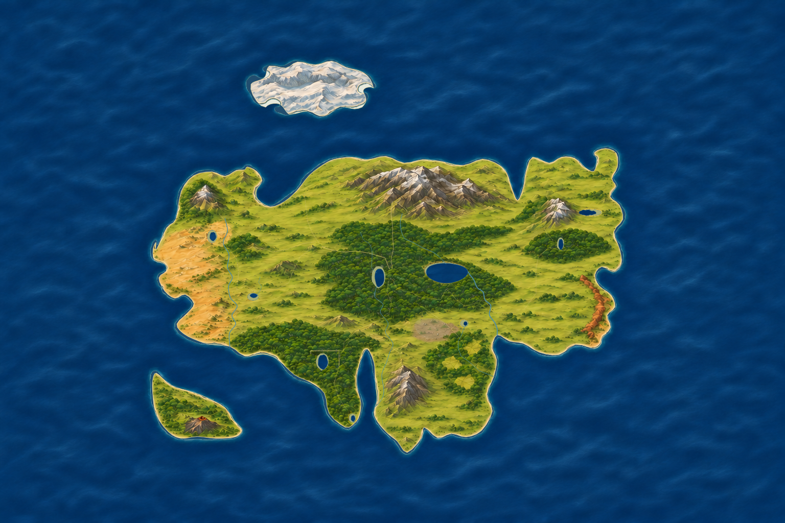

# Current painting and official geographical reference

| Current original presentation | Official illustrated reference |
| --- | --- |
|  |  |

The official artwork remains an external link, credited to the Tensura official portal. It was not copied into the repository or used as an image-generation input. The right-hand illustration is enduring geographic reference, not proof of exact S1E10 political borders or every initial building.

The left follows current authored source `dc92845` / SHA `1ea6782d…`:3 native coasts,9 lakes,8 rivers,21 roads and58 source-derived anchors in the [numbered atlas](atlas.png). The northwestern bay, northern massif, southern gulf and eastern continental lobe are adapted to fixed server ranges. Exact coast vertices, relative compression, habitat extents and road courses remain interpretation. C05/C07/C14/C20/C22 and broader source/coverage/build-fit/runtime requirements remain open.

The [review](README.md) explains the updated Ice coast, Orbic habitat, Imperial basin and native overlay audit. Snow, tree and ridge strokes are pictorial. This side-by-side presentation is not an independent source or a claim that every wiki location has been reconstructed.
