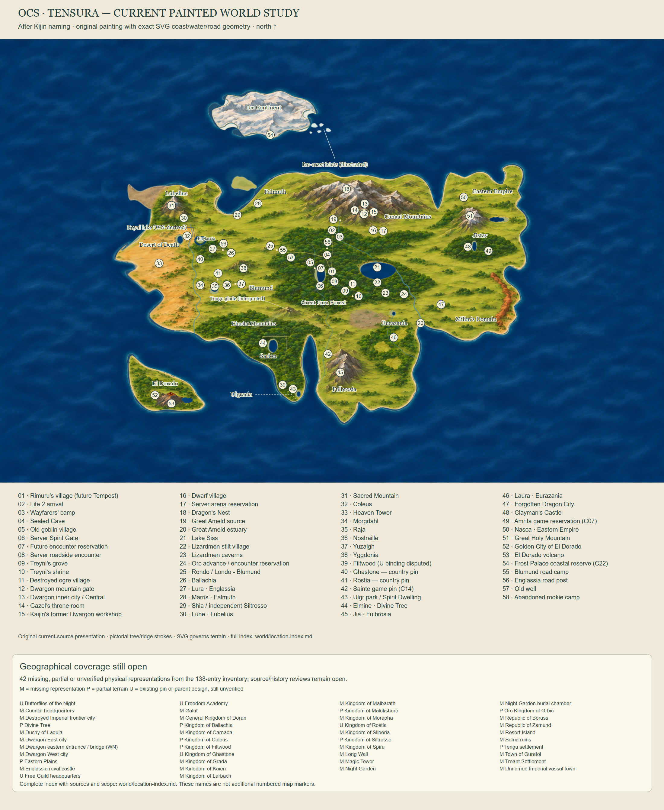

# Painted Tengu terrain context - R100

[Editable atlas](atlas.svg) · [native continent](continent.svg) · [continent PNG](continent.png) · [enlarged before/after](comparison.png) · [comparison notes](comparison.md) · [independent audit](audit.json) · [58-site registration](site-registration.json) · [provenance](provenance.json)

The painting follows [R99 source geography](../tengu-glade-r99.md), map commit `696115d8f9947f9d00e4daab3294190a2de0d75a`, source **dbef5ac01a2e22f6aca9182527fc6610295f385da9fec2058ccf2f52cd833197**. R98 remains the preceding historical painting.

The new meadow wash uses the **exact 28 source vertices** of the interpreted Tengu ridge glade. The existing R98 native composition is retained apart from root metadata and this small addition. Its height-light basis still matches the current normal height file exactly; there is no new relief, road or village construction.

Only **15 continent pixels** change, maximum RGB-channel difference **87/255**, bounds x670..674/y624..627. Every changed pixel centre lies inside the glade's declared 16-world-block stroke/antialias support. All exterior pixels remain exact. The enlarged comparison deliberately shows the original painting pixels; it is not a detailed village model.

The atlas now has **20 context names**. Tengu glade (interpreted) and its leader match the main atlas's authored world positions. The Khusha orientation text follows its new main-atlas position. All **58 site attributes, world coordinates and projections** remain checked and unchanged. Every other marker, leader, label and panel element retains its XML/layout, apart from declared image/source metadata and the Tengu coverage row changing M to P. Actual browser boxes are recorded for all 20 labels.

The caption remains **138 inventory entries / 42 open physical follow-ups**. Tengu is partial terrain context, not a registered or completed settlement. Its surface-path proposal remains inactive under C15; no drawn road, house, flat court, later trade tunnel or WN gate is added. Exact parcel, meadow choice, wash and palette are **our interpretation**. No initial building date or resident roster is inferred from later sources.

The full atlas, local detail, enlarged comparison, source checker preview and current terrain study were visually reviewed. Browser checks find 58 numbers, 20 names and 42 open rows, without label/number or label/label overlap; minimum bubble spacing remains 32.47px. No further production SVG correction was identified after this painting review. Ledger **305** and the broader source/location/initial-era obligations remain unchanged.

The adopted source checker was rerun: 0 errors, all 56 relations pass, 2 existing warnings. Its fresh preview, source SVG and current terrain previews remain identical to the main map branch. Source, model and atlas checks are not Minecraft placement or walking acceptance.

PNG files are browser exports of original native SVG compositions. No new generated image, raw raster editing, copyrighted reference pixels, historical art/prompt edit, protected implementation or tool change, new normal export, terrain application, chunks, main merge or deployment. Older hidden native history remains retained; this pass does not newly verify all of its resource paths. Repository gate: 472 tests, 26 skipped, zero failures (63.658s); zero changed JavaScript.
