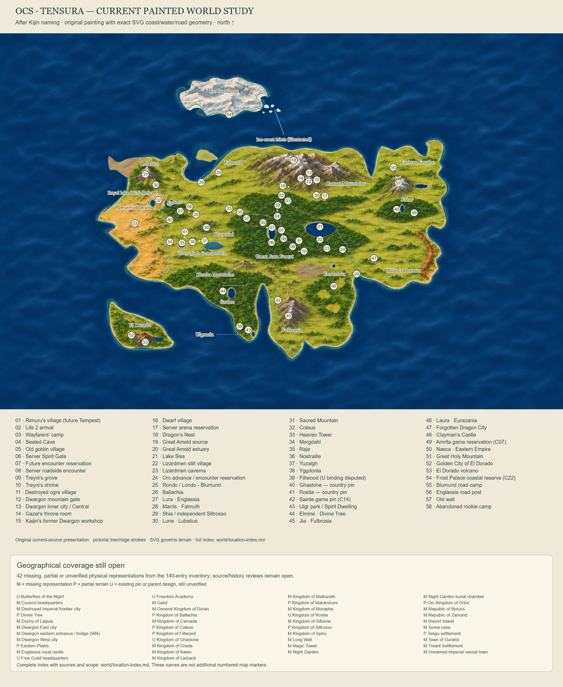

# Painted western basin alignment — R105

[Editable atlas](atlas.svg) · [native continent](continent.svg) · [continent PNG](continent.png) ·
[enlarged before/after](comparison.png) · [comparison notes](comparison.md) ·
[independent audit](audit.json) · [58-site registration](site-registration.json) · [provenance](provenance.json).

The painting follows R104 source geography at map commit `b36f284`, normalized
source **e785c2b0a37105994f29ed4eae0f48fa8884b57d334a80c0811a350bfac7ed74**.
R100 is the preceding historical painting. The source/terrain/checker previews
adopted here match the map branch exactly. No source geometry is changed in this
painting pass and no further source correction was identified from this review.

The unnamed western lake uses the exact40 source vertices; both river strokes
use the exact36 source vertices. The water stroke is8 world blocks,matching the
source; a14-block translucent under-stroke supplies bank ink. The new water wash
is original procedural SVG colour/noise clipped to the exact lake shore. Palette,
ink,shoreline and precise position remain interpretation,not a named LN lake.
No copyrighted reference pixels or new AI image are introduced.

The R100 native composition is retained except for declared root metadata,
water overlay and its definitions. Exactly **1304 continent pixels** change,
within x505..610/y567..695. Every changed pixel centre lies inside the declared
16-world-block stroke/antialias support; every exterior pixel remains identical.
Current normal terrain height differs from R100 near the new water,so no false
whole-file height identity or new global relief resampling is claimed.

The atlas retains58 source site attributes,world coordinates and projections,
20 context names and42 open physical rows. Its caption now says140 inventory
entries; the ledger is310. All prior numbered groups and other atlas XML remain,
apart from the image/source metadata,caption/panel metadata and Blumund label.
Blumund's orientation text follows the source's northward move,then receives a
20px eastward layout adjustment to clear marker37 in the painted projection.
Its actual interpreted world text position and browser box are recorded; this
moves no place,water shape or country boundary. All other text positions stay.
Browser checks cover58 circles/20 labels/42 rows without label/number or
label/label overlap; minimum circle spacing32.47px.

The native continent,full atlas,local detail,enlarged comparison,current checker
preview and official-reference comparison links were reviewed. Existing source,
initial-era,C12/C22,whole-city and runtime obligations remain open. The current
coastal Frost Palace reserve is retained pending Yasuke's placement decision.
No later political outcome or visit is activated in the S1E10 snapshot.

PNG files are Chrome exports of original native SVG compositions. No raw raster
editing,protected implementation change,art/prompt edit,normal terrain rebuild,
world application,Minecraft chunks,main merge or deployment. Hidden historical
native composition is retained; this pass does not newly audit all historical
resource paths. A matching painting is not in-game terrain/placement acceptance.

Repository gate: **472 tests,26 skipped,zero failures(64.430s)**.
Validation,zero changed-JavaScript check and `git diff --check` pass.
Adopted source checker:0errors/56relations/2existing warnings.
