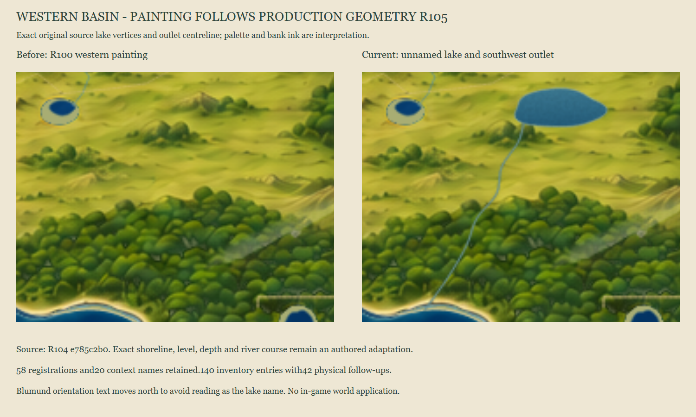

# Western water comparison — R105

Left: R100 landscape. Right: the same landscape with the exact original R104
western lake and outlet geometry. Reference evidence and deliberate geometric
differences remain in [the source review](../western-basin-r104.md) and
[the official-reference comparison](../comparison.md). The official illustration
is linked rather than copied into the repository.

Only1304 native continent pixels change,all inside the declared16-block
ink/antialias support. Exterior pixels are identical. The cropped enlargement
shows the original painting pixels,not a higher-detail terrain model. Water and
banks follow the source; this does not certify final Minecraft flow,vegetation,
noise,chunk generation or an exact canonical shoreline.

Blumund orientation text moves north and slightly east to stay distinct from
the lake and numbered bubbles. The58 place registrations remain exact. Inventory
caption140/42 and ledger310 agree with the adopted source scope. R100 is
historical; broader source and physical obligations remain open.
