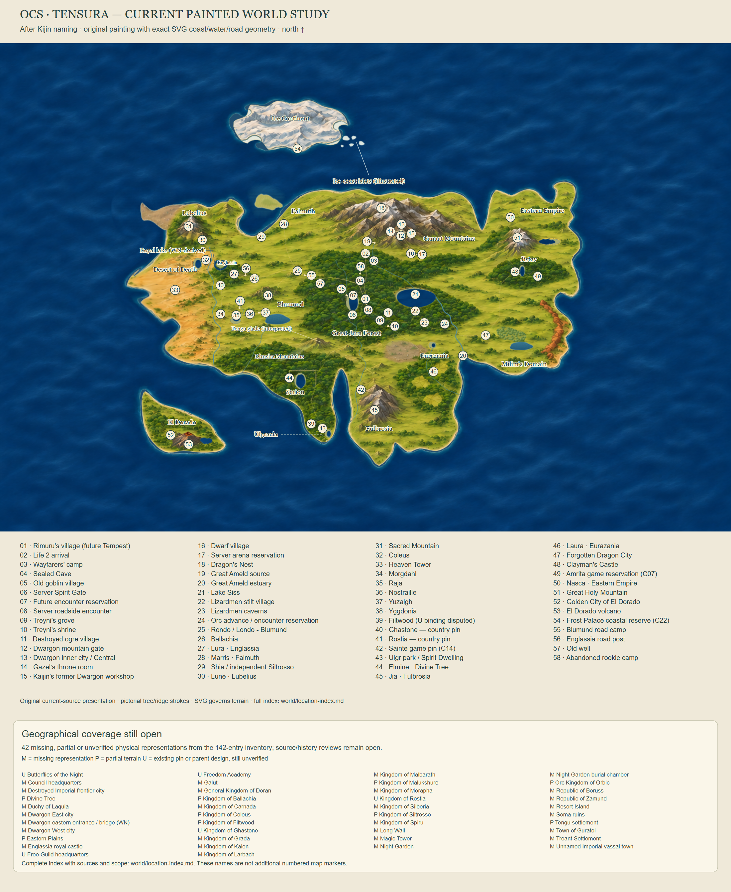

# Painted southeastern water and woodland alignment — R107

[Editable atlas](atlas.svg) · [native continent](continent.svg) · [continent PNG](continent.png) ·
[before/after](comparison.png) · [notes](comparison.md) · [independent audit](audit.json) ·
[58-site registration](site-registration.json) · [provenance](provenance.json) ·
[original tree symbols](tree-symbols.json).

The painting follows R106 production source at map commit `b0e38d0`,normalized
SHA **b275095000ed41e635c72295d05dbd3516cf8fd0c596a7a0e7a9fe14159815e1**.
R105 is the preceding historical painting. Source,checker and current terrain
previews adopted here match the main map branch exactly. No production geometry
changes in this painting pass; no further source correction was identified from
this visual review.

The unnamed southeastern lake retains all36 source vertices; the woodland wash
and canopy clip retain all66 source vertices.55 original decorative tree symbols
are scattered deterministically inside that exact woodland,with varying canopy
sizes and a minimum centre distance; a regular-row trial was replaced after
visual review. The count,placement,species,palette and apparent density of these
symbols do not prescribe the trees Minecraft generates. Water grain clips to
the exact lake shore; the trees and wash are original native SVG illustration.
The forest remains north/northwest of the water,as in the source visual reading.

The R105 native composition remains except declared source metadata,definitions
and local overlay. Exactly **2213 continent pixels** change,bounds
x1043..1120/y594..644. Every changed pixel centre lies inside the declared
16-world-block ink/antialias support; every exterior pixel is identical.
No global relief resampling or byte-identical normal-height claim is made.

All58 source site attributes,world positions and projections are retained.
20 context names and42 open rows are browser-checked with no label overlaps;
minimum numbered-circle spacing32.47px. Caption and panel metadata now say142
inventory entries/42 physical follow-ups; ledger312. Milim orientation text
moves south to the source's new interpreted text position,clear of the new
water. No place or other text position moves. Actual context positions and
browser boxes are recorded. The atlas embeds the exact final continent PNG.

Native continent,full atlas,local detail and enlarged comparison were inspected
beside the adopted checker/terrain and linked official-reference comparison.
The earlier western basin/outlet and all other current geography remain.
Exact shore,location,level,depth,forest boundary,type,species and initial state
retain their source/design qualifications. C12/C22,country/capital,whole-city
and broader source/physical/initial-era obligations stay open. The coast/inland
palace response is still pending; no approval is inferred from elapsed time.

Chrome exports produce the PNGs from original native SVGs. No copyrighted
reference pixels,new AI image,raw raster editing,protected implementation,
historical art/prompt edit,normal terrain rebuild,world application,chunks,
main merge,deployment or in-game acceptance. Hidden historical native content
is retained; this pass does not newly audit all historical resource paths.

Repository gate: **472 tests,26 skipped,zero failures(65.227s)**.
Validation,zero changed-JavaScript and `git diff --check` pass.
Adopted source checker:0errors/56relations/2existing warnings.
