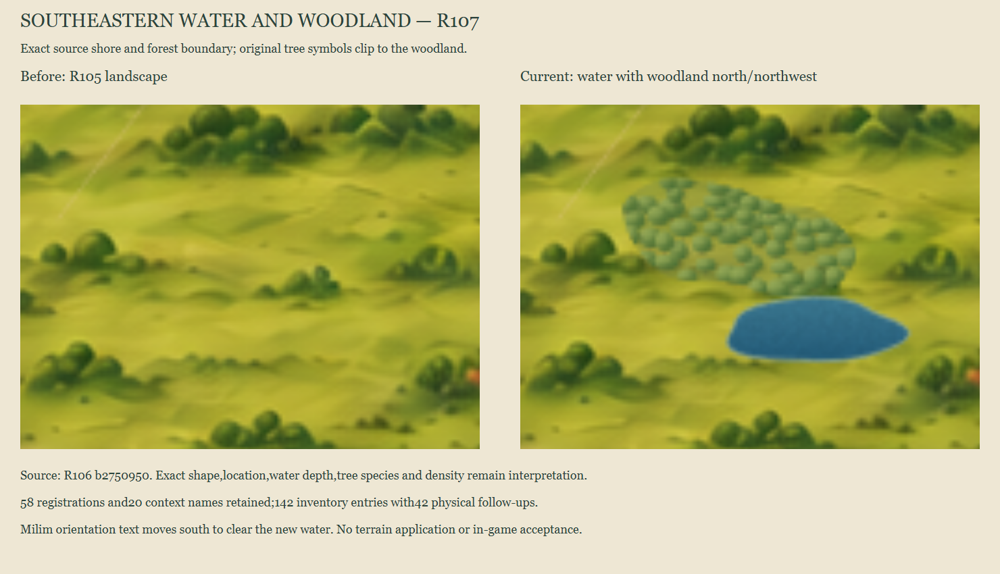

# Southeastern water and woodland comparison — R107

Left:R105 landscape. Right:the same painting with the exact original R106 lake
and woodland geometry. Original symbols inside the forest are a visual language,
not a canonical tree count or exact Minecraft planting plan. The lake is unnamed;
no unverified outlet,capital or border is introduced.

The [source review](../southeastern-water-wood-r106.md) and
[official reference links](../comparison.md) retain the evidence and deliberate
differences. Copyrighted reference images stay outside the repository.

2213 native continent pixels change,all inside the16-block ink/antialias support;
all exterior pixels remain identical. The enlargement shows original painting
pixels,not higher-resolution terrain. No final noise,vegetation density,water
flow,chunk generation or in-game placement is certified by the comparison.

Milim orientation text follows the source's southward move to clear the water.
All58 registrations and other text positions are retained. Caption142/42 and
ledger312 agree with current source scope. R105 is historical; broader source
and physical obligations remain open.
