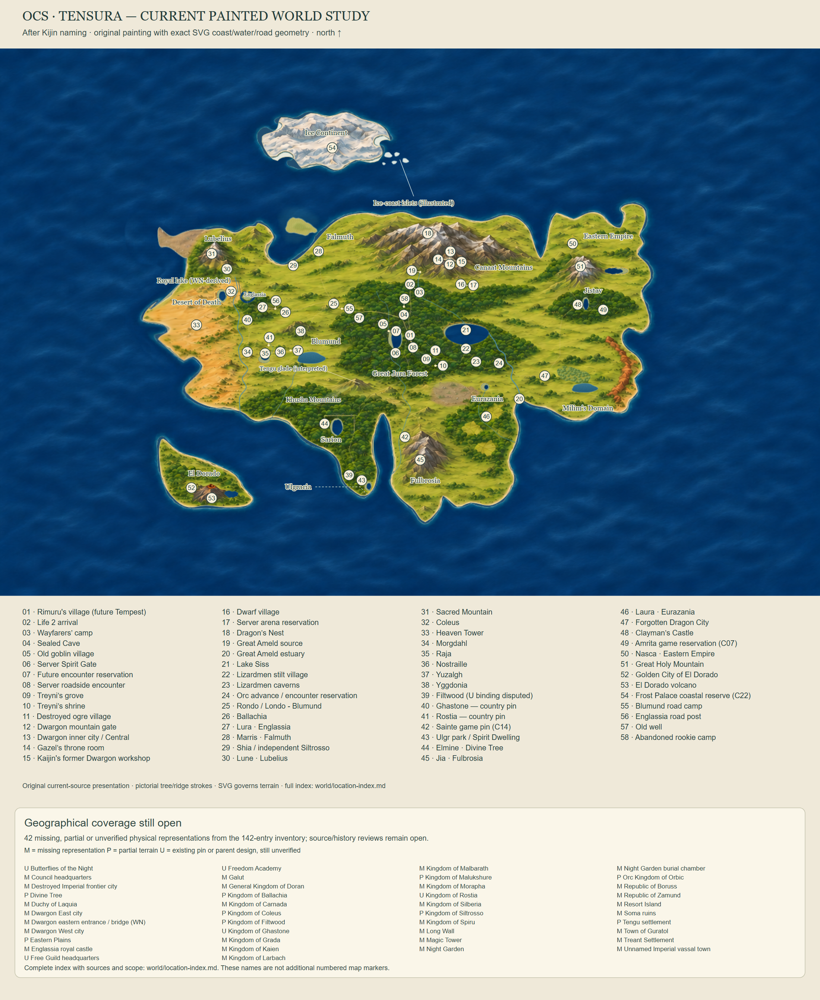

# Painted atlas follows the inland palace decision — R110

[Native continent](continent.svg) · [editable atlas](atlas.svg) · [before/after atlas](comparison.png) · [audit](audit.json) · [58-site registration](site-registration.json) · [provenance](provenance.json).

Follows owner-approved R109 map commit `5026a0d841818950c1cc364e7ed47e7d0e2492ac`,source SHA `0ae040ec3779d96d6efac288cdc46cfaf5339b1deeafbcfcf3c07224fa6f3c2b`. Frost Palace marker54 moves from(-1500,-3310)to(-1530,-3680),inside the reviewed central snowfield. Its title now says inland clearing. The exact source forecourt is translated in the native SVG.

The underlying continent PNG is **pixel-identical** to R107: the small dashed forecourt lies beneath the existing snow composition at this scale. Native source geometry and metadata still follow the approved map. The atlas visibly moves marker54 and its pointer;the other57 marker groups,20 context names and42 open rows retain their positions. No global relief resampling or claim of pixel-for-pixel equivalence to the normal height export is made. All R107 native XML stays except that forecourt and source metadata;all other atlas XML stays except embedded image/root metadata and the two site54 groups.

All58 world coordinates and projections match current source. Browser inspection checks58 circles,20 names,42 rows;no label overlaps;minimum circle spacing32.47px. Caption remains142/42;registration ledger314 includes the new owner-approved design record. Source/checker/current terrain previews adopted from main match exactly. Main checker0errors/56relations/2priorwarnings;normal67.3s is the R109 staging run,not a new painting run.

Yasuke resolved the coast/inland choice. WN central-continent evidence remains WN-qualified;LN agreement,complete palace architecture,initial-era access and runtime integration remain open. The existing generator updates Frost Palace kind/r registration under owner approval;no tools implementation,pack,mod,live anchor,Minecraft chunks,main merge,deployment or in-game acceptance occurs here. Existing copyrighted references remain linked only;no new AI image or raw raster editing.

Required repository gate:472tests,26skipped,zero failures(64.953s);repository validation,zero changed-JavaScript and `git diff --check` pass. Original before/after and browser atlas positions visually reviewed.
