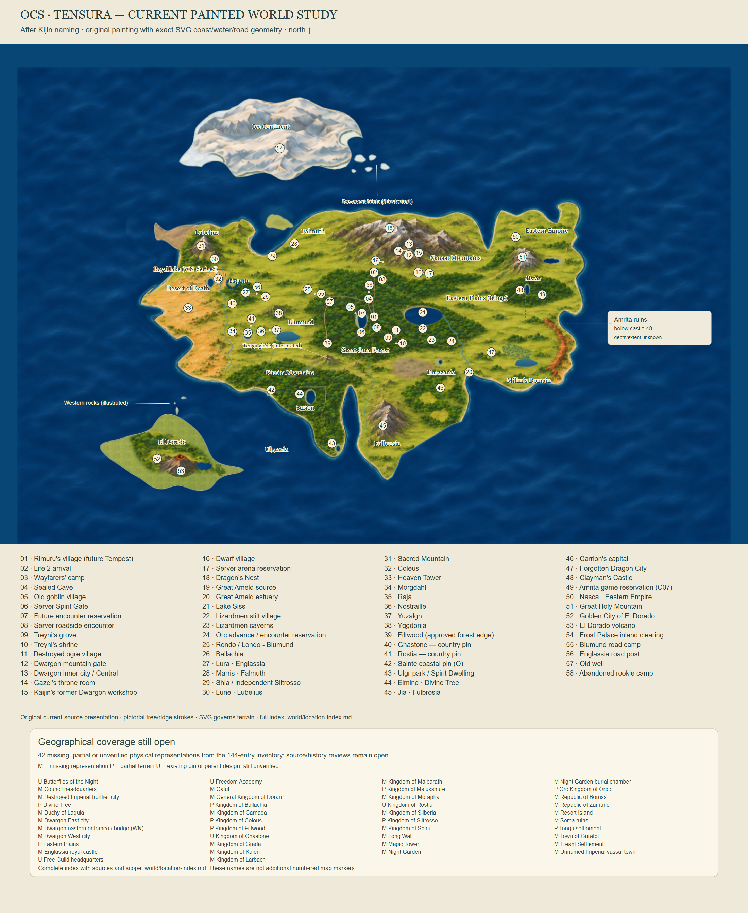

# Current source-aligned painted atlas

Yasuke's selected larger islands and coastal Malukshure are active. Source `36c77b45ee33edb37d737e062327ae936eeae68eeb6904d5054b4325196a8627`;58sites and24roads. [Adoption/limits](../approved-islands-coast.md) · [source geometry](../map.svg) · [same-frame terrain comparison](current-source-comparison.png) · [58-site registration](site-registration.json) · [browser anchor verification](../approved-islands-coast-atlas-check.json) · [component provenance](provenance.json).

The current painting frame is[-8448,-6144,16896,11264]. Original island brushwork is transformed and clipped to the selected coasts;the coastal cape and approach are drawn in native SVG. Existing mainland brushwork and the original project textures are retained. No copyrighted reference pixels or new AI raster generation are used. Rendering follows the editable SVG. This is an illustration,not an exact reconstruction of numerical heights or actual Minecraft structures.

The two numbered atlases match current source coordinates at all58anchor points each. Browser matrix checks also caught and corrected inherited Filtwood marker/leader errors. The22context labels remain orientation aids;42physical follow-ups remain visible,not additional numbered sites. Four concept placement sheets are updated while exact generation prompts and original PNGs remain retained.

The same-frame comparison crops both the actual normal terrain and original painting to the current13824by11264normal box. The actual normal export ran in91.6seconds withoutskipcheck. All13finite lake cases pass;strict native land coverage has0unassigned centres. The required repository gate has3legacy-registration failures plus validation;no world apply or deployment occurred. Claude's coordinated Amrita nesting,registration refresh and Minecraft acceptance remain pending.

[Previous presentation state](https://github.com/Yasuke2000/ocs-two-lives/blob/f0d8825ee399b364a69168f4a0240b0bb135a7e2/world/painting-round112/README.md) preserves earlier composition/source history. Nested provenance records retain their historical sources;the approved_islands_coast record identifies this current update. Older unchanged-bitmap,smaller-island and pending-owner claims describe earlier versions.
