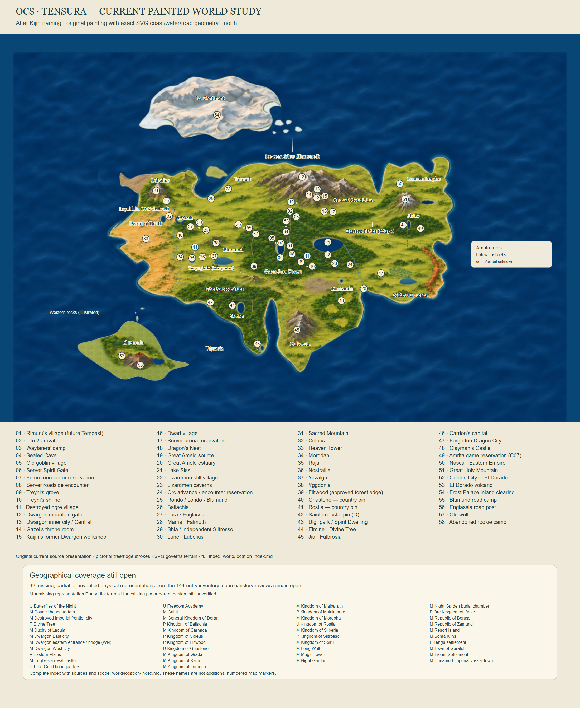

# Amrita association on the painted atlas — R124

[Measured scope](amrita-association-r124.json) · [Source review/PR111](https://github.com/Yasuke2000/ocs-two-lives/pull/111).

The painted atlas now makes the same below-castle relationship visible as the terrain atlas: a dashed leader from castle48 to the Amrita caption. Marker49 remains the separately labelled game reservation. The leader is a relationship annotation, not a road, access shaft, surveyed centroid, underground extent or depth assignment. C07 technical nesting/access remains open.

The [official episode81 synopsis](https://www.ten-sura.com/anime/tensura/story/no86) supports the ancient ruins beneath the former castle (OFF-AMR-001). The [publisher LN10 fragment](https://gcnovels.jp/reading/slime10.htm) separately distinguishes the ruin defences and the surface city (LN10-001/002). No later expedition, excavation, encounter or changed ownership is projected into S1E10. This follows an existing source claim, without adding a duplicate ledger entry. No copyrighted reference pixels are incorporated.

Every prior atlas root child, including the embedded continent image, remains exact; only one caption group is appended. Continent SVG/PNG, original audit, provenance and58-site registration are byte-identical to2738634. Thus R120 geometry/paint evidence retains its original scope rather than being rewritten. Actual changed atlas pixels are bounded in the JSON. Browser inspection finds58 numbers,20 prior context labels plus3 caption lines and42 inventory rows, with no text/number or text/text overlaps and minimum numbered spacing32.47056px. The actual detail was visually inspected for legibility and placement.

This annotation does not change source4093, terrain exports, site registry, rules, structures, runtime or chunks, and is not a whole-map or initial-era acceptance claim. The continent remains the R120 native brook/coast painting. No new terrain conversion/checker run is needed or claimed for unchanged geometry. All remaining source/proportion/era boundaries stay open.

Required gate `bash tools/check.sh`: validation passed;472 tests,26 skipped,zero failures in63.870seconds. Zero changed JavaScript files. `git diff --check` passed.
