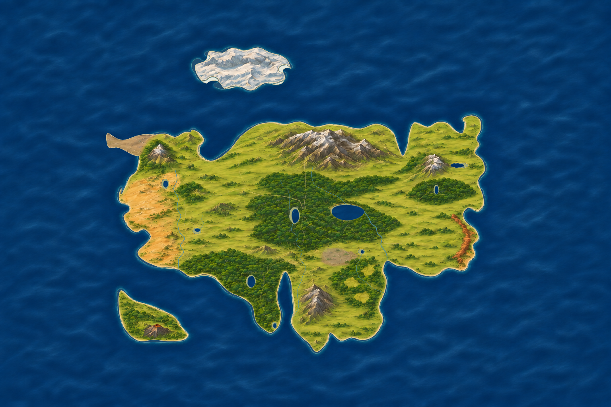

# Current source, painted continent and official reference

| Current original presentation | Official illustrated reference |
| --- | --- |
|  |  |

The official artwork is linked externally and credited to the Tensura official portal. It is not copied into this repository or supplied to image generation. It provides enduring geographical reference, not surveyed country boundaries or proof of every initial-era building. The current source/headland study is [world/western-cape-review.md](../western-cape-review.md); current terrain/checker previews govern geometry. R38 and earlier paintings remain historical at their recorded source hashes.

The source-backed visual cue is the northwestern western arm. Its exact original curve, barren habitat and V gameplay assignment remain our interpretation under C12. Native coast/water/road vectors and all 58 marker projections are audited in [presentation-audit.json](presentation-audit.json). Added terrain texture stays local to that headland; tree/ridge/soil strokes elsewhere retain the earlier original art. The [marked atlas](atlas.png) includes16 context names and the existing32-entry open-coverage panel. Physical site reservations, political snapshot and known source constraints are retained; neither this comparison nor a matching mask proves full wiki or runtime coverage.

Production decision after visual review: retain source7d021766. No additional coast, water, relief, forest, road or reservation change is justified by this painting. The three earlier requested painting/SVG reviews remain delivered historically; this later refresh brings the painted presentation to the current source without rewriting that history.
