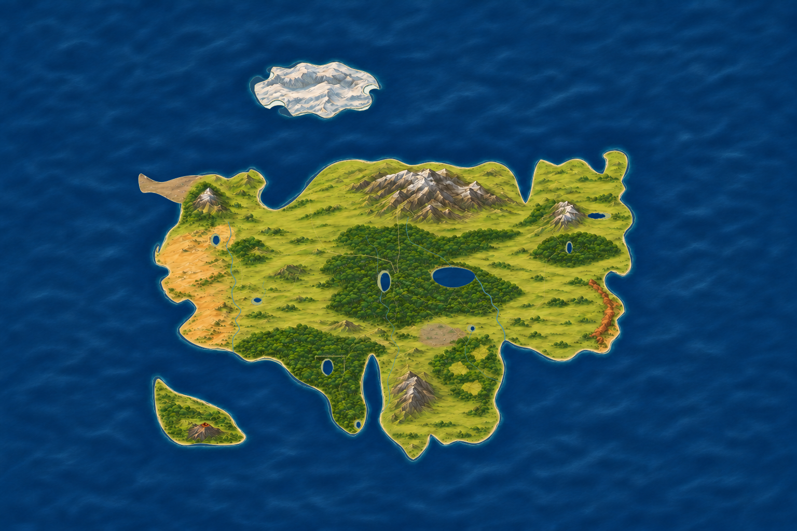

# Current-source painting and official geographical reference

| Original presentation with current native geometry | Official introductory map |
| --- | --- |
|  |  |

Official artwork is credited and linked externally; it is not copied into this repository or used as an image-generation input. The fixed frame,58-site constraints and existing directions prevent an exact official-map projection; [regions.md](../regions.md) records those deliberate differences. Relative large-scale orientation remains: Ice Continent north, Eastern Empire east of Canaat/Jura, El Dorado offshore southwest, Sarion southwest of Jura, Fulbrosia south of Jura and Ulgracia south of Sarion. Exact shore curves, habitat extents and gameplay region lines remain our interpretation.

Round50 updates only the native presentation against sourcecb07cce7. Original R38/R43 pigments remain; their tree, ridge, soil and bank strokes do not add surveyed terrain. R43's source7d021766 presentation is preserved historically. Native current coast/water/road vectors,58 projections and browser text containment are checked in [presentation-audit.json](presentation-audit.json).

Painting-to-SVG decision: retain current production source. No further change was justified by this visual review. The official chapter6/9 screenshots depict later political situations; the selected server era stays immediately after Kijin naming. Full source completeness, missing places, fixed-rule conflicts, structure fit and live-server acceptance remain open.
