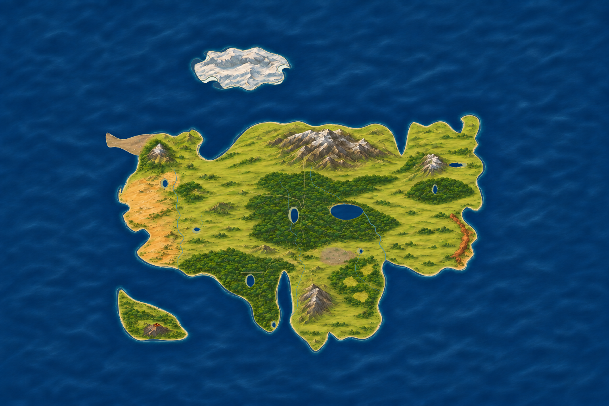

# Source8c24a349 presentation and official geographical reference

| Original current-source presentation | Official introductory map |
| --- | --- |
|  |  |

Official artwork is linked externally and credited to the Tensura official portal. It is not copied into this repository or used as an image-generation input. Fixed58-site distances and C12 projection differences prevent an exact illustrated-map projection; [regions.md](../regions.md) records them. The exact new Dwargon foothill/forecourt shape and block heights are our interpretation for the fixed template,not a canonical survey.

Round53 adds native analytical lighting for that actual terrain change over the previous original art. The two source masks,666 current/baseline height samples,all coast/water/road vectors,58 positions and browser label bounds pass their audits. Raw original textures and earlier R50/R43 compositions remain historically intact. All1,387 changed composition pixels lie in the local96-block relief review buffer; the remaining continent and sea pixels are retained.

Painting-to-SVG decision: retain production source8c24a349. No further map change was justified by the local detail,whole presentation,terrain view and official-reference review. Later official chapter6/9 political situations are not imported into the initial post-Kijin snapshot. Full source/coverage/fixed-rule/era/fit/runtime obligations remain open.
