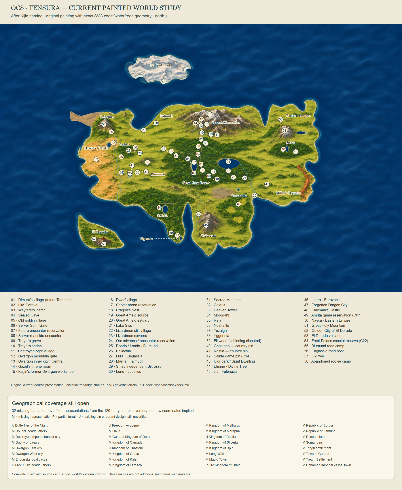

# Painted atlas matched to the Englassia preparation update — round61

[Editable atlas](atlas.svg) · [continent image](continent.png) · [editable composition](continent.svg) · [audit](audit.json) · [provenance](provenance.json) · [lighting samples](relief-samples.json) · [58-site registration](site-registration.json)

This original presentation follows production source7a30cf41 from map commit121b8fc. [R60's measured Englassia update](../englassia-fit-review.md) enlarged one terrain-preparation radius98→124 and changed its exported walking height75→76. The original R53 composition was reviewed against earlier source geometry; it is retained unchanged as historical work. R61 is an explicit current-source integration, **not a claim that the old and new terrain are identical**.

## What changes in the painting

A native SVG layer uses the current-minus-baseline designed-height gradient around Englassia. The input is the normal four-block export, sampled at8-block cell centres;1,634 samples are recorded. Northwest illumination follows positive(dx+dz) for normal(-dx,1,-dz). Alpha is quantized to1/4096 so the small terrain adjustment is not amplified. The layer is restricted by the existing coast clip and the current preparation/fade envelope: radius124 plus62-block fade, with4-block feathering.

Only31 pixels of the1536 ×1024 continent export differ from R53, at most2/255 in an RGB channel. Every changed pixel centre is within170.04 blocks of the Englassia anchor; the audit allows the186-block envelope plus48 blocks for filtering. This is deliberately subtle: it does not paint a giant new city or pretend that a one-block walking-level change defines new national geography. No original raster texture is edited and no new AI image is generated. Both PNGs are normal browser exports of the native SVG compositions.

## Geometry and layout verified

All3 coast outlines,9 lakes,8 rivers and21 roads retain exact current source geometry. Two existing native habitat overlays and the R53 Dwargon lighting remain. Coast clipping/ocean masking match the current source. The painted tree and ridge strokes remain illustrative, not a metric biome or height map.

All58 site IDs,world x/z positions and page projections match current source7a30cf41. The atlas retains every number,leader,16 contextual names and32 open inventory rows. Browser-measured text boxes clear the numbered bubbles;15 full stroked labels remain inside their interpreted gameplay masks. The Ulgracia callout ends inside its mask. Minimum numbered-bubble centre spacing remains32.47px. These are presentation checks, not surveyed sovereign borders or proof of extra registered locations.

The existing original texture hashes and every R53 file remain unchanged. Raw artwork provenance leads back to the original R38/R43 generation records; copyrighted official/anime references remain links and were not generation inputs. Production SVG,checker preview,current terrain exports,blueprints,tools and runtime code are unchanged in this presentation round.

## Era and remaining work

The world snapshot remains immediately after the six ogres are named Kijin, anime S1E10. Early village and intact Laura remain distinct from later expansion/events. C14 Sainte's game pin,C22 Frost Palace coastal reservation and the other recorded fixed-rule conflicts remain marked; their inert alternatives are not silently painted as active geography.

Ledger248 unique records,14 direct printed-LN claims and3 separately classified author-side-story claims remain. The129-entry inventory still has32 coverage follow-ups;58 original place-art pairs remain delivered separately. Complete primary-source evidence,missing distinct locations,underground registration,other template fit checks and local in-game acceptance remain open. No extra settlement,main merge,terrain application,Minecraft chunks or deployment is made. Visual review did not justify another production geometry change.

Repository validation and 472 tests pass (26 skipped, zero failures, 62.281 seconds); zero changed JS files. Current normal height inputs were read from the map worktree's verified R60 staging export; this presentation round does not rerun the converter or apply terrain.
