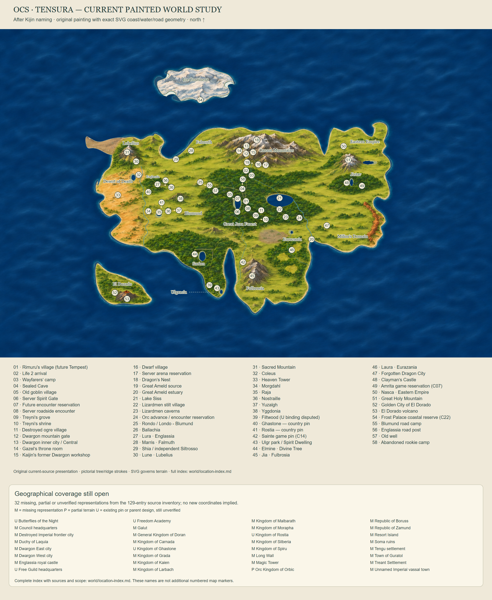

# Painted summit and high-pass update — round63

[Editable atlas](atlas.svg) · [continent PNG](continent.png) · [native composition](continent.svg) · [audit](audit.json) · [provenance](provenance.json) · [lighting samples](relief-samples.json) · [measured change mask](change-mask.json) · [site registration](site-registration.json)

This presentation integrates production source **0b211ec7**, map commit80c1198. [R62's Dragon's Nest preparation](../dragons-nest-fit-review.md) changed the local summit and the graded Canaat approach. R63 follows those measured changes without asserting whole-source equivalence to the earlier R61 painting. Original R53/R61 files and the underlying original textures remain unchanged.

## Cover the approach as well as the summit

The normal export changed2,507 four-block height cells. Of these,205 lie beyond the nest's85-block preparation radius plus42-block fade because the road-grade adjustment propagates along the unchanged high-pass route. A circle-only painting update would miss that part of the terrain change.

The new native SVG mask follows the union of **all2,507 changed height cells**, with a16-block blending buffer and4-block feather. Its bounds are(208,-2144) to(608,-1832). The mask JSON preserves the exact measured footprint and blend shape;these are illustration controls,not new terrain or canonical borders. The SVG outline is checked against the measured mask within0.0001 blocks of rounding tolerance.

Lighting uses863 height-difference gradient samples at8-block spacing. The audit independently resamples the current and baseline four-block height inputs and recomputes gradient,sign and quantized opacity. Northwest light uses positive(dx+dz) for normal(-dx,1,-dz). Current normal height inputs come from the map worktree's verified R62 staging export;this presentation round does not rerun the converter or apply terrain.

Only402 pixels of the1536 ×1024 continent differ from R61,maximum28/255 in an RGB channel. All changed pixel centres are within8.25 blocks of the measured height-change footprint. Fifty-three changed composition pixels lie beyond the127-block site/fade circle,so the approach contribution is represented rather than clipped away. The visual change is local;the painting remains an illustration,not a metric height or biome map.

## Registration and retained source geometry

The native3 coasts,9 lakes,8 rivers and21 roads retain exact current source geometry,together with two existing native habitat overlays. Coast clipping and ocean masking match0b211ec7. The earlier Dwargon and Englassia light layers remain byte-identical as elements. No raw raster texture is edited or new AI image generated;PNG files are browser exports of native SVG compositions. Copyrighted references remain links and were not generation inputs.

All58 current site IDs,world x/z positions and page projections are verified. Number bubbles,leaders,16 contextual names and32 open inventory rows stay unchanged. Browser measurements verify text-box clearance,15 full stroked labels inside the current gameplay masks,and the Ulgracia callout endpoint. Number-bubble centre spacing remains at least32.47px. These checks validate the presentation;they do not survey political borders or add locations.

## Era and remaining scope

The snapshot remains immediately after the six ogres are named Kijin,anime S1E10. Later Tempest capacity and story events are not activated. The source/fixed-rule alternatives and their confidence remain in the map comments and contradiction register. Inert alternatives are not silently painted as active geography.

Ledger250 unique records,14 directly read printed-LN claims and3 separately classified author-side-story claims remain. The129-entry inventory retains32 missing,partial or unverified representations;58 original place-art pairs remain delivered separately. This round adds no geographical claim or production geometry change. Other measured template-fit differences,primary-source gaps,missing locations,registration and local Minecraft acceptance remain open. No main merge,terrain application,chunk generation or deployment.

Repository validation and 472 tests pass (26 skipped, zero failures, 62.501 seconds); zero changed JS files. Source hashes, original texture hashes, native source vectors, measured mask, all 863 lighting samples, site projections and browser layout are checked. No local Minecraft run is claimed.
