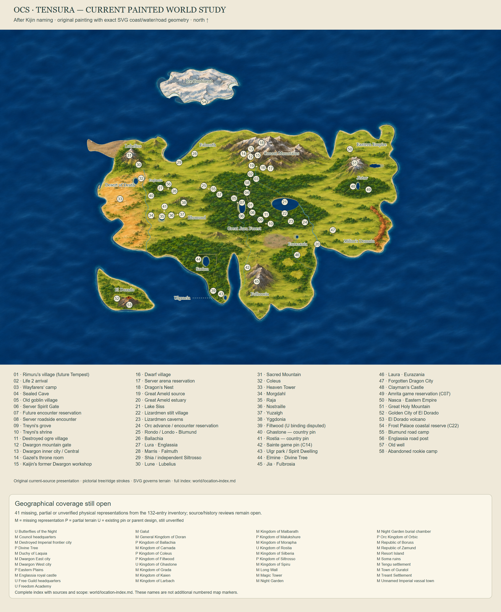

# Current painted atlas — round64

[Editable atlas](atlas.svg) · [retained R63 continent](../painting-round63/continent.png) · [audit](audit.json) · [source equivalence](source-equivalence.json) · [site registration](site-registration.json)

This atlas uses source **c2f806a9**. Its full active XML tree is identical to R63 source0b211ec7: the only production-source edit is an inert Night Garden proposal inside the existing C15 comment. A normal65.9-second export confirms all13 non-index files byte-identical; index changes only its source hash. All58 sites and21 road profiles remain unchanged. No terrain is applied.

The original R63 landscape, including its measured summit/high-pass lighting, is reused unchanged. No new AI image or raster edit is involved. Native coasts, lakes, rivers, roads,58 number registrations and16 context labels retain their previous geometry. Only the open-coverage panel changes:41 physical follow-ups from132 inventory entries. Browser measurements verify41 rows without overlap or panel clipping; pixel differences are confined to that panel. Earlier R53/R61/R63 files remain unchanged.

Two newly listed missing representations are Night Garden and its burial chamber. Seven existing partial records are now displayed too: Divine Tree, Eastern Plains, Ballachia, Coleus, Filtwood, Malukshure and Siltrosso. The earlier32-name panel undercounted those partial records. Historical Night Rose and broader source/history/era questions remain open beyond this physical-coverage count.

[Night Garden study](../night-garden-plan.md) keeps underground dimensions, levels and access explicitly unverified design choices. It creates no active city, room, structure or resident. The initial era remains immediately after Kijin naming, S1E10; later political changes in the official chapter maps are not imported. Ledger254 unique records:196 thematic/design/reference plus58 coordinate interpretations;14 directly read printed-LN and3 separately classified author-side-story claims remain.

The complete map is still under review. Fixed-rule/source decisions, missing locations, template fit, technical registration and local Minecraft acceptance remain open. No main merge, deployment, chunk generation or in-game validation is claimed.

Repository validation and472 tests pass (26 skipped,zero failures,62.851s);zero changed JavaScript files. This validates repository integrity and presentation,not complete canon coverage or underground runtime placement.
