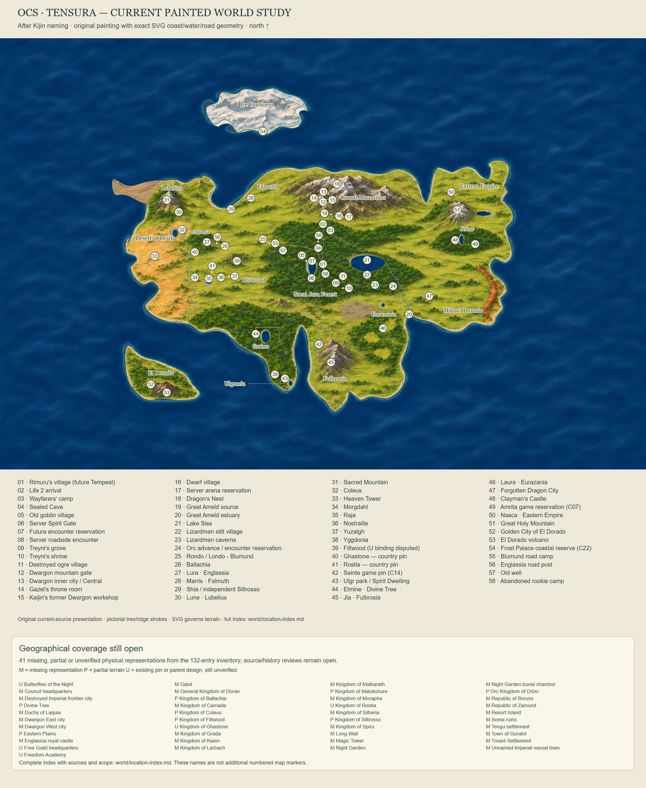

# Painted Sacred Mountain and approach update — round69

[Editable atlas](atlas.svg) · [continent PNG](continent.png) · [native composition](continent.svg) · [audit](audit.json) · [provenance](provenance.json) · [lighting samples](relief-samples.json) · [measured change mask](change-mask.json) · [site registration](site-registration.json)

This presentation integrates terrain source **90ee15b1**,map commitf98dd7b. [R68's Sacred Mountain support review](../sacred-mountain-fit-review.md) enlarged its preparation80→95 and changed the automatic first-air179→175,with associated shoulder and approach terrain. R69 follows those measured changes. R64 reused the R63 landscape;the new composition starts from that retained R63 image/vector and uses the unchanged R64 atlas layout. It does not assert whole-source equivalence to the earlier sourcec2f806a9.

## Include the shoulder and approach

The normal export changed4,483 four-block height cells. Of these,**1,003 lie beyond the current95-block preparation radius plus48-block fade**. A circle-only update would omit part of the real terrain change. The new native mask follows the union of all4,483 changed cells,with a16-block visual blend buffer and4-block feather. Bounds:(-4076,-1760) to(-3672,-1384). The mask matches the measured footprint within0.0001 blocks of SVG rounding tolerance;it is an illustration control,not new terrain or a canonical frontier.

Lighting uses1,335 height-difference gradient samples at8-block spacing. The audit independently resamples both normal4-block height inputs and recomputes gradients,northwest light sign and quantized opacity. This uses **bilinear sampling for illustrative lighting**,not a claim to execute the complete runtime Catmull-Rom,density,noise or placement pipeline. Current inputs are the verified R68 normal export;no converter rerun or terrain application occurs in this presentation round.

Only**473 pixels** of the1536 ×1024 continent change from the completed R64 landscape,maximum28/255 per RGB channel. Every changed pixel centre is within16.30 blocks of the actual height-change footprint. There are222 changed composition pixels beyond the143-block preparation/fade envelope,so the approach contribution is included. The painting remains a stylized illustration,not a metric heightmap,exact site-clearing raster or biome classification map.

## Geometry and registration

Native geometry matches the current source for3 coasts,9 lakes,8 rivers and21 roads,together with two prior habitat overlays. Coast clipping and ocean masking are verified. Every previous non-patch composition element and definition is retained,including earlier Dwargon,Englassia and Dragon's Nest lighting. Every original R53/R61/R63/R64 file and raw texture hash remains unchanged. No raster texture is edited or new AI image generated;PNGs are browser exports of native SVG. Copyrighted references remain links and were not generation inputs.

All58 site IDs,x/z positions and page projections are checked. Every non-image atlas element remains exactly as in R64:58 number groups/leaders,16 contextual names and41 open inventory rows. The latter match the current132-entry coverage CSV by name. Browser measurements verify row containment,text/number clearance,15 full stroked labels inside gameplay masks and the Ulgracia callout endpoint. Number-bubble spacing remains at least32.47px. These are presentation checks,not surveys of national borders or completed settlements.

## Era and remaining work

The snapshot stays immediately after Kijin naming,anime S1E10. Later Tempest expansion,political outcomes and story residents are not activated. Existing game-pin/coastal-reserve qualifications and inert source/fixed-rule alternatives remain. R69 adds no geographical fact,source SVG edit or active location. Ledger261 unique(203 thematic/design/reference +58 coordinate interpretations),14 directly read printed-LN and6 separately classified author-side-story claims remain. Inventory132/41 physical follow-ups,plus broader historical/source/era/fit questions,remain open.

R69 closes the painting-integration follow-up for the R68 terrain change. It does not complete the faithful-world goal or local Minecraft acceptance. No main merge,protected runtime/tool edit,terrain apply,chunk generation or deployment.

Repository validation and472 tests pass (26 skipped,zero failures,63.417s);zero changed JavaScript files. Current source/vector/mask/gradient/site-registration/browser-layout audits pass. These checks validate source registration and presentation,not complete lore coverage or in-game placement.
