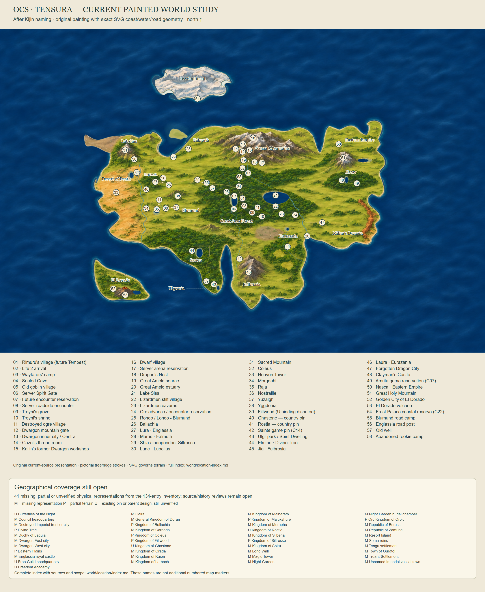

# Painted eastern El Dorado lake and bank — round 81

[Editable atlas](atlas.svg) · [continent PNG](continent.png) · [native composition](continent.svg) · [independent audit](audit.json) · [provenance](provenance.json) · [bank-light samples](relief-samples.json) · [measured change footprint](change-mask.json) · [58-site registration](site-registration.json)

This presentation follows production source **9fd0c5fb**, map commit **d3ad9ea**. [R80](../el-dorado-lake-review.md) added an unnamed lake-like basin east of the El Dorado volcano after comparison with the official illustration. R81 now includes that exact shore and the associated bank change in the painting. The name, outlet and initial S1E10 water condition remain unverified; the shore, position, water level and nominal depth remain R80’s authored interpretation.

The art branch adopts the R80 source by merge. Rendering adds no further production geometry: the source SVG and checked preview remain identical to map commit d3ad9ea. No extra source correction was justified by the final lake/preview/reference comparison.

## Local composition

The verified **R78 PNG is the underpainting**, with its original editable nodes and definitions retained in the hidden `retained-r78-native-composition` group. The original R78 SVG, PNGs and textures remain unchanged. The new lake polygon uses the exact current source geometry and the existing original water-wash texture. The bank uses 648 independently checked bilinear height-difference gradient samples at eight-block spacing under northwest illustrative light.

The native mask follows all **2123 changed four-block height cells**, plus a 16-block visual buffer. It therefore includes the bank as well as the lake bed. Colour, texture and lighting remain presentation choices; the picture is not a metric height/depth map or a simulation of runtime noise, water placement or erosion. The configured nominal depth 5 and sampled R80 shallows of 1.3125..5 blocks remain export interpretations rather than surveyed canon measurements.

Only **361 pixels** change from the 1536×1024 R78 continent, maximum 171/255 per RGB channel. Bounds are pixels (419,826)–(447,841); every changed pixel centre is within **10.75 blocks** of the actual height-change footprint. The small blend/antialiasing fringe is local. Pixels outside this measured local update remain identical. No raw raster pixels were edited and no new AI image generated; the PNGs are browser exports of the SVG composition.

## Geometry and registration

The retained and new source-vector nodes are checked for four coasts, ten lakes, eight rivers, 21 roads and two prior habitat overlays. The unchanged coast clip and ocean mask match the four current landmasses. The visible new lake’s 26-vertex polygon exactly matches the production lake. All earlier editable composition nodes and definitions, including the northern island, survive unchanged; their visible appearance is preserved by the checked underpainting.

All **58 site IDs, x/z coordinates and page projections** are checked. All non-image atlas elements match R78 except the inventory caption 133→134. Browser measurements verify 58 numbered bubbles, 16 context names and 41 open rows; text clears padded number boxes, 15 full stroked labels remain inside their gameplay masks and the Ulgracia leader ends in U. The F mask is checked as the union of its mainland/island polygons. Minimum bubble spacing remains 32.47px. The atlas embeds the exact new continent PNG.

The inventory contains 134 records and the displayed 41 physical follow-ups match its names. Ledger 280 unique records, 14 directly read printed-LN and 6 author-side-story claims are unchanged. The unidentified lake is terrain-present; painting it does not locate any missing settlement or close broader source/era questions.

## Initial era and handoff

The snapshot remains immediately after Kijin naming, anime S1E10. No later city growth, political outcome, residents or lake construction date is activated. The [official introductory map](https://www.ten-sura.com/4GfGdAp7/wp-content/themes/tensura_portal/assets/images/portal-map/world/intro/map-base.webp) is a reference link; its pixels were not embedded or used as image-generation input.

R81 closes R80’s painting-integration follow-up. It does not complete the faithful-world goal. Other source, location, initial-state and fixed-rule decisions remain open. Technical conversion and placement remain Claude’s handoff. No converter rerun, terrain application, chunks, main merge, protected runtime/tool edit or deployment in this presentation round.

Visual review: the current continent, complete atlas, local lake detail and official reference were inspected. The lake stays east of the cone; markers remain readable. No additional production SVG correction was identified.
