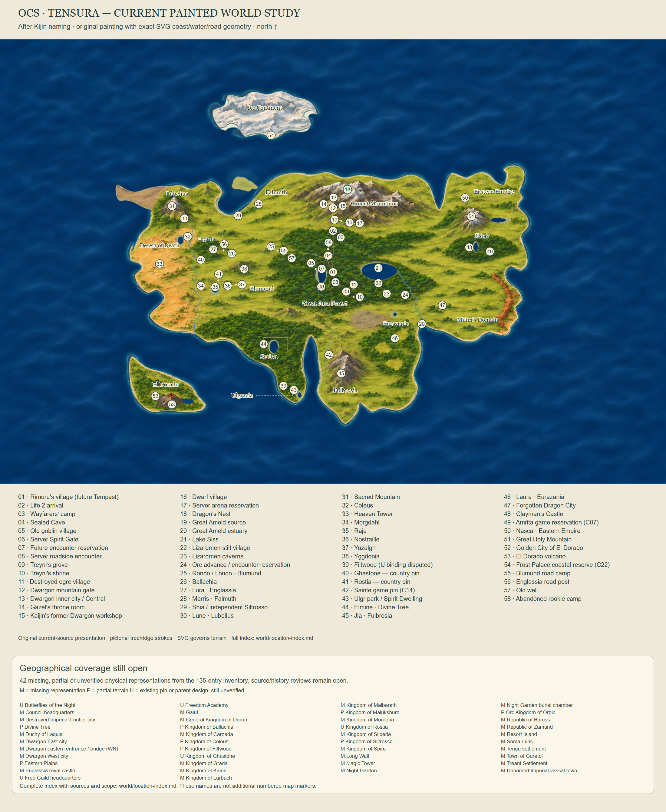

# Current painted atlas — coverage refresh, round 85

[Editable atlas](atlas.svg) · [audit](audit.json) · [unchanged R81 continent](../painting-round81/continent.png) · [R81 native composition](../painting-round81/continent.svg) · [R81 terrain/registration audit](../painting-round81/audit.json)

This follows map commit 3587f19 and source 9fd0c5fb. The [R84 review](../dwargon-crossing-source-review.md) separately tracks the continuity-qualified WN entrance/bridge complex. The coverage panel now contains **42 open rows from 135 inventory entries**; the ledger has 285 unique records. The 134 previous inventory records/statuses remain intact. The new complex is unlocated; it is not a placed bridge or an extra numbered site. Revised LN/anime equivalence, C13/C15 and exact initial state remain unresolved.

Only panel rows and the count caption differ from R81. Every other atlas XML element, including the embedded continent image, 58 registrations, 16 context names and transforms, is unchanged. R81's original continent, composition and all prior artifacts are retained. No new painting, AI image, raster editing or terrain geometry is introduced; the new PNG is a browser export of the edited native SVG. R81 retains its lake/bank integration and measured limits.

The selected snapshot is still immediately after Kijin naming (anime S1E10). The coverage panel lists unresolved representations, not additional initial settlements or activated later events. Broader primary-source, fit, continuity, location and era obligations remain open. Technical terrain conversion and placement belong to Claude. No production SVG change, converter rerun, runtime application, chunks, protected implementation/tool edit, main merge or deployment.

The rendered coverage panel was inspected. Independent comparison finds 19,658 changed pixels, all within the panel (bounds x65..815,y2238..2575). Browser measurements verify every row fits and rows do not overlap. All 42 names/statuses match the current inventory.

Validation: `tools/check.sh` passes: 472 tests, 26 skipped, zero failures (63.024s). Historical R81 art is unchanged against commit2c62a5e. No in-game acceptance is claimed.
