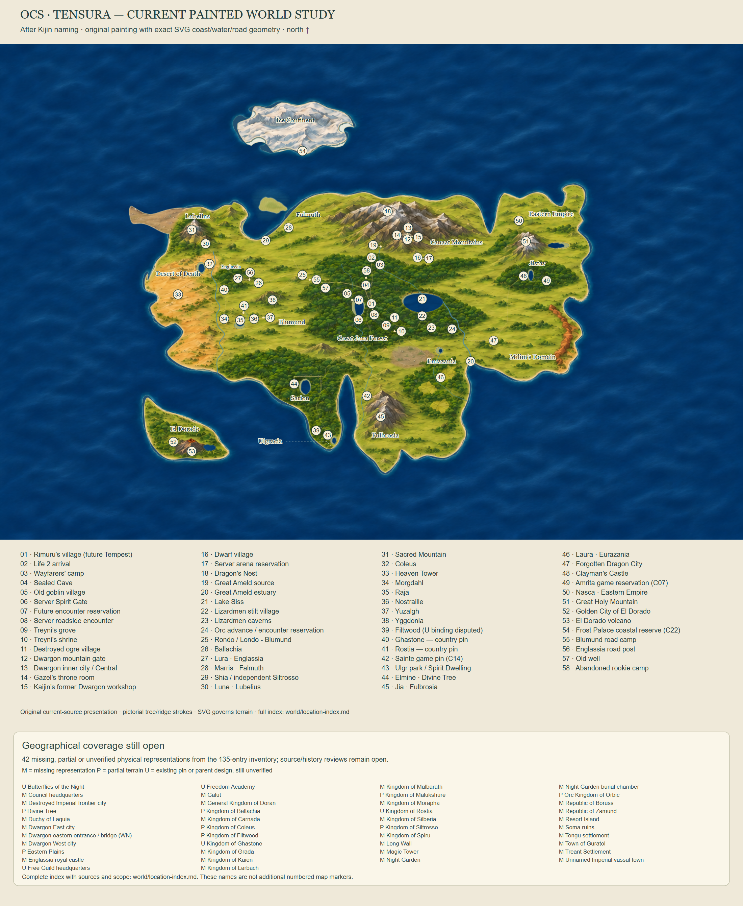

# Painted northeast Dwargon — round 87

[Source comparison](comparison.md) · [Editable atlas](atlas.svg) · [continent](continent.png) · [native composition](continent.svg) · [audit](audit.json) · [58-site registration](site-registration.json) · [provenance](provenance.json) · [light samples](relief-samples.json) · [change masks](change-mask.json)

This painting follows [R86's current geography](../dwargon-relocation-r86.md), map commit `7cd04dc`, source `355d1a338f7dccf835123ff7af6a68cfda3319363378c60f7f04359cab67d3a7`. Dwargon, its three relative pins, the dwarf village and arena now appear at their current authored locations. The three revised roads and local relief follow the same source. No further production SVG correction was identified by the final terrain/painting comparison.

## Native reconstruction and local light

The unchanged R81 continent is the underpainting. Its earlier editable nodes and definitions are retained. To remove the old road strokes, the original R69 native composition is rendered with only the three moved routes omitted. Every other node and definition in that reconstruction remains identical. The original R69 composition rerenders with **zero changed baseline pixels** using the recorded Chrome software-rendering configuration.

[Native ground reconstruction](native-dwargon-patch.svg) and its [PNG](native-dwargon-patch.png) are intermediate assets, used only through a local mask. They are not a standalone current-continent delivery: their historical context omits the later northern island and El Dorado lake. The final continent retains both through the current underpainting. The old three source-road strokes are absent from the reconstructed ground; the final SVG draws each current route once. Together with the unchanged 18 routes, all 21 source polylines match the current geometry. This avoids leaving an obsolete road beneath the new route.

The separate incremental light layer contains **9,013 checked samples** at eight-block spacing. It uses current-minus-prior normal-height gradients, with opacity capped below 0.16, to suggest the moved approach relief. It is illustrative light, not an absolute elevation, biome-voxel or runtime-density render. Lake and river buffers exclude this glaze; the new road's bridge stroke remains possible above water. A rejected combined filter pass changed unrelated colours; separating the ground, light and final road layers avoids that dependency.

The mask covers the 33,272 changed height cells plus 16 blocks and the complete old/current strokes of the three revised routes plus 12 blocks. Shared sections remain included for coherent dash phase and edge rounding. **3,769 continent pixels change**, maximum 83/255 per RGB channel, bounds x743..880,y349..526. Changed pixel centres lie within **5.08 blocks** of the combined buffered support, including antialiasing. This is not a claim that every changed pixel lies inside the actual height-change cells. Pictorial trees and brush texture do not certify individual generated features or clearing acceptance.

## Registration and coverage

All **58 site IDs, world x/z values, anchor projections, leader endpoints and bubble positions** are checked. Six groups move; the other 52 keep their positions. The Canaat orientation label moves within the D gameplay mask to clear the cluster. Browser checks retain 16 context names, no padded name/number overlaps and minimum bubble spacing 32.47px. All 15 full stroked in-mask names fit their masks; the Ulgracia callout remains unchanged. The atlas embeds the exact new continent PNG.

The **135-entry inventory and 42-row coverage panel** are unchanged from R85; names/statuses match the current CSV. The ledger remains **286 unique records**. R87 adds no geographic claim, extra registered site or completed city. All historical art files, original painted textures and the separately aligned 58 place concepts are retained.

## Snapshot and remaining work

The snapshot remains immediately after Kijin naming, anime S1E10. No later political outcome, settlement growth, bridge discovery or highway construction is activated. The underlying source is unchanged after adopting R86. The current source preview, native reconstruction, local painted atlas and linked official geography were visually compared. No copyrighted reference pixels are embedded or supplied to image generation; no new AI image or direct raster editing is used. New PNGs are browser exports of the native SVG compositions.

This closes only R86's painting/registration follow-up. The 42 physical follow-ups and broader source, continuity, proportional, fit and initial-state questions remain open. Technical conversion and placement belong to Claude. No converter rerun, terrain application, Minecraft chunks, protected runtime/mod/tool edit, main merge or deployment.

Validation: required checker **0 errors, 56/56 relations, 2 existing warnings**. Repository gate **472 tests, 26 skipped, zero failures (63.210s)**. Final full atlas visually inspected.
