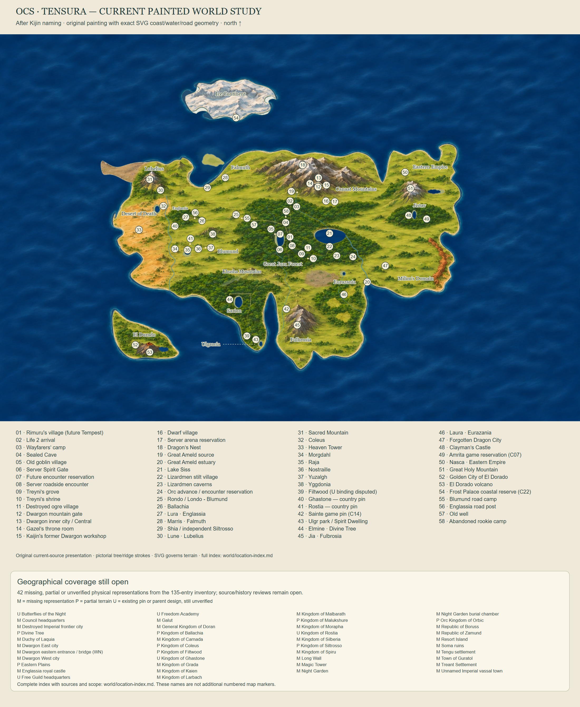

# Painted Khusha continuation — round 90

[Editable atlas](atlas.svg) · [continent](continent.png) · [native composition](continent.svg) · [source comparison](comparison.md) · [independent audit](audit.json) · [registration](site-registration.json) · [light samples](relief-samples.json) · [change mask](change-mask.json) · [provenance](provenance.json)

The painting now follows [R89's Khusha continuation](../khusha-continuation-r89.md), map commit `6a21005`, source **2ce669a04d878cf18c4ae9ed7b22ccd48f9e2dfcefdc944deeeba07091431b5f**. The lower mountain envelope and unequal summit relief are represented by local illustrative light, with a restrained tint at the actual new rocky summit cells. The source preview, current terrain comparison, local painted detail and full atlas were visually reviewed. No further production SVG correction was identified by this comparison.

## What changes

The exact R87 continent PNG is the underpainting; its complete earlier native SVG is retained, hidden and unmodified. A separate native SVG layer uses **3,446 checked samples** on an eight-block grid. Central height differences from the current and prior normal exports produce incremental directional light, capped at opacity 0.35 and softened over four world blocks. This suggests the new terrain without repainting the rest of the continent. The 117 actual changed rocky-biome cells receive a small, half-opacity original rock tint.

The layer is clipped to actual changed-height cells buffered by 16 blocks, with lake/river buffers excluded. **1,859 continent pixels change**, maximum RGB-channel difference **94/255**, bounds x575..661,y629..673. Every changed pixel centre lies within that buffered support. This is not a claim that every pixel lies within the raw height-change cells, nor that pictorial trees reproduce exact generated vegetation. The light is illustrative; it does not encode absolute elevation, continuous density, collision or walkability.

Coastlines, water, the northern island, the El Dorado lake and the previously aligned Dwargon roads remain in the original underpainting. R89 did not change any road, watercourse or site coordinate. No extra scene, settlement or completed tunnel is introduced.

## Registration and naming

All **58 site records** are identical to R87, and their world coordinates and projected anchor points match the current source. The marker groups, leaders and previous 16 context labels retain their exact atlas XML/layout. A seventeenth name, **Khusha Mountains**, uses the same interpreted world position as the current terrain atlas, including that atlas's parent transform. It names a range, not a country or political border.

All 17 context-position metadata records are refreshed from actual SVG coordinates and browser boxes. This also corrects stale context-position metadata inherited by R87; the earlier 16 visible labels do not move. Browser checks find no label/number or label/label overlap. Minimum bubble spacing remains **32.47px**. Previous country-label mask fits remain valid by unchanged country masks and unchanged visible labels; no country-mask fit is asserted for the new range label.

The **135-entry inventory and 42-row coverage panel** are unchanged. The ledger remains **290 unique records**. No missing location is declared complete by this presentation update.

## Snapshot and remaining work

The snapshot remains immediately after Kijin naming, anime S1E10. R89's exact mountains, elevations and terrain dimensions remain authored interpretations of the qualified source relationship. Future encounters, political changes, later tunnel construction and later settlement development stay inactive.

This closes only the R89 painting follow-up. The 42 physical follow-ups and broader source, continuity, scale and initial-state questions remain open. Production SVG, checker preview and terrain atlas are unchanged after adopting R89. No converter rerun, terrain application, Minecraft chunks, protected runtime/mod/tool edit, main merge or deployment. Claude handles technical conversion and placement.

No copyrighted reference pixels are embedded or supplied to image generation; there is no new AI image or raster editing. New PNGs are browser exports of original native SVG compositions. Historical painting files and original place-concept PNGs remain unchanged.

Validation: source checker **0 errors, 56/56 relations, 2 existing warnings**. Repository gate **472 tests, 26 skipped, zero failures (62.994s)**; zero changed JavaScript.
