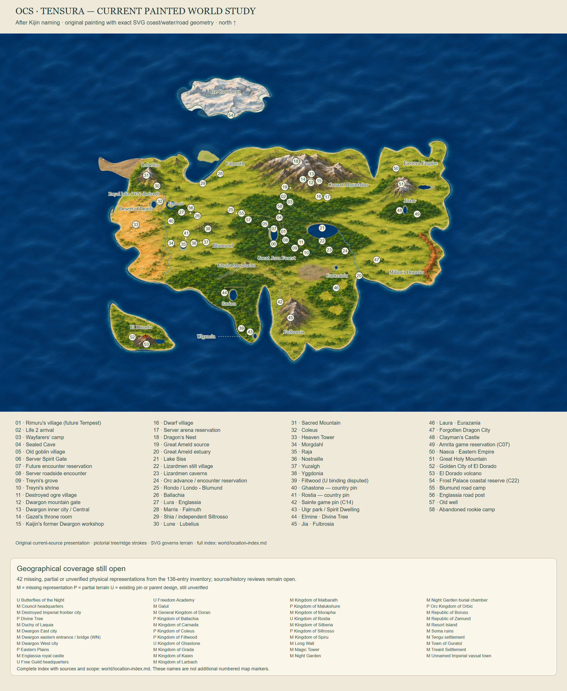

# Painted Englassia capital water — round 92

[Editable atlas](atlas.svg) · [native continent](continent.svg) · [continent PNG](continent.png) · [before/after](comparison.png) · [source comparison](comparison.md) · [independent audit](audit.json) · [58-site registration](site-registration.json) · [provenance](provenance.json)

The painting follows [R91 production geography](../englassia-lake-r91.md), map commit `f0e1d63e7d1668c42c9152047f604cea2ff55331`, source **43fed30354a1aeca839b8ac3c13dc0ab16c200af62332695dc72c3cb7238ad9a**. This supersedes R90 as the current painted presentation. R90 remains unchanged as historical evidence.

## Local reconstruction

The exact R90 PNG supplies the underpainting; its entire native SVG remains hidden and unmodified. A clipped reconstruction from the established native composition removes the former local road segment, adds the active lake polygon and court clearing, updates the existing Blumund–Englassia–Lubelius route and adds the Englassia–Coleus trail. All 22 native road records and the new lake/court vertices match the production SVG. The original court wash and water styling are illustration choices.

The patch support combines actual changed-height cells buffered by 16 blocks, changed old/new road segments buffered by 16 blocks, and the lake/court footprints buffered by 16 blocks. An independently checked set of **863 eight-block light samples** uses current-minus-prior height gradients. This is illustrative bank light, not absolute elevation, a depth map, measured foliage, collision or runtime acceptance.

**955 continent pixels change**, maximum RGB-channel change **224/255**, bounds x431..493,y447..485. Changed pixel centres lie at most **4.331 world blocks** outside the clipped support because of raster antialiasing (checked tolerance8.5 blocks). The exterior remains the exact R90 underpainting. No unrelated continent reconstruction or new generated image is introduced.

## Names and registration

All **58 site records, world coordinates, projected anchors, numbered marker groups and existing leaders** remain unchanged. The previous17 context labels retain their positions; **Royal lake (WN-derived)** brings the total to18. A new leader points at the lake rather than the unchanged academy precinct. The name states its source qualification and does not claim a political region.

The inventory caption is now **136**, retaining the existing **42 open rows**. Stale inherited panel attributes (132/41) are corrected to136/42; the visible rows retain their XML/layout. All18 context-position records are checked against actual SVG coordinates. Browser checks find no label/number or label/label overlap; minimum bubble spacing **32.47px**. Existing country-mask fits remain valid by unchanged masks and unchanged previous visible labels; no political-mask fit is asserted for the new lake callout.

## Sources, era and limits

[Author WN56](https://ncode.syosetu.com/n6316bn/59/) supplies the qualified capital-water setting. [R91 primary-source review](../../docs/research/tensura-world-2026-11-19/englassia-source-review-r91.md) distinguishes directly read paragraphs from inaccessible printed-LN samples and bounded official episode20 stills. The exact basin position, shape, level, clearing and approach routing are our interpretation. No LN/anime equivalence or S1E10 construction proof is claimed.

The snapshot remains immediately after Kijin naming, anime S1E10. No castle model, completed capital, later political outcome, named roster or story event is introduced. The source SVG's castle footprint remains inert/unregistered and is not painted as a building. C17 remains partial; extra-city registration, whole-capital design, source continuity and initial construction remain open.

Ledger294 and inventory136/42 remain unchanged by this presentation pass. These counts do not certify exhaustive wiki review. Historical concept PNGs and exact prompts remain unchanged. No copyrighted reference pixels are embedded or supplied to image generation; PNGs are browser exports of original native SVG compositions. No production geometry correction was identified after visual comparison with the R91 terrain preview and original before/after study. No normal export rerun, terrain application, Minecraft chunks, protected runtime/mod/tool edit, main merge or deployment; Claude handles technical conversion and placement.

Validation: adopted source checker **0 errors,56/56 relations,2 existing warnings**. Repository gate **472 tests,26 skipped,zero failures (64.466s)**; zero changed JavaScript.
