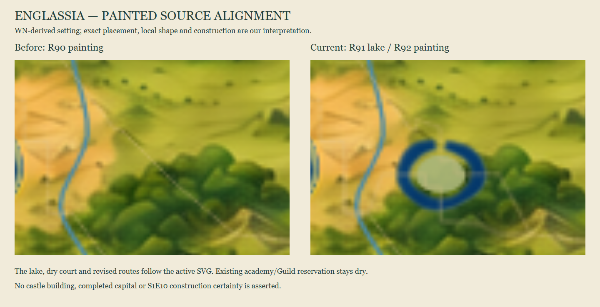

# R92 source comparison

The right panel is the new original SVG composition; the left is the unchanged R90 PNG. Both use the same world frame. Compare with the [R91 original terrain study](../englassia-lake-r91.png) and [active terrain atlas](../atlas.png). The new lake wraps a dry court northwest of the unchanged academy/Guild reservation. The northern opening is land; the other approaches cross water. No castle building is depicted.

The complete continent follows the same established authored coastline and existing deliberate adaptations documented in [regions](../regions.md). This round changes no production geometry or source priorities. The [official interactive map](https://www.ten-sura.com/map) remains a separate copyrighted geographical reference; its pixels are not included here. Later chapter screenshots inform stable geography without adopting their later political state. The Englassia lake itself is qualified by [author WN56](https://ncode.syosetu.com/n6316bn/59/) rather than by those screenshots. Exact local implementation is original design.

Visual review includes the final checker preview, full painted atlas, an enlarged painted lake detail and both original before/after studies. The atlas has58 numbers and18 context names. The new callout avoids the existing numeric bubble and Englassia text. No further production SVG correction was identified; remaining capital/era/source obligations are explicit in the [review](README.md).
