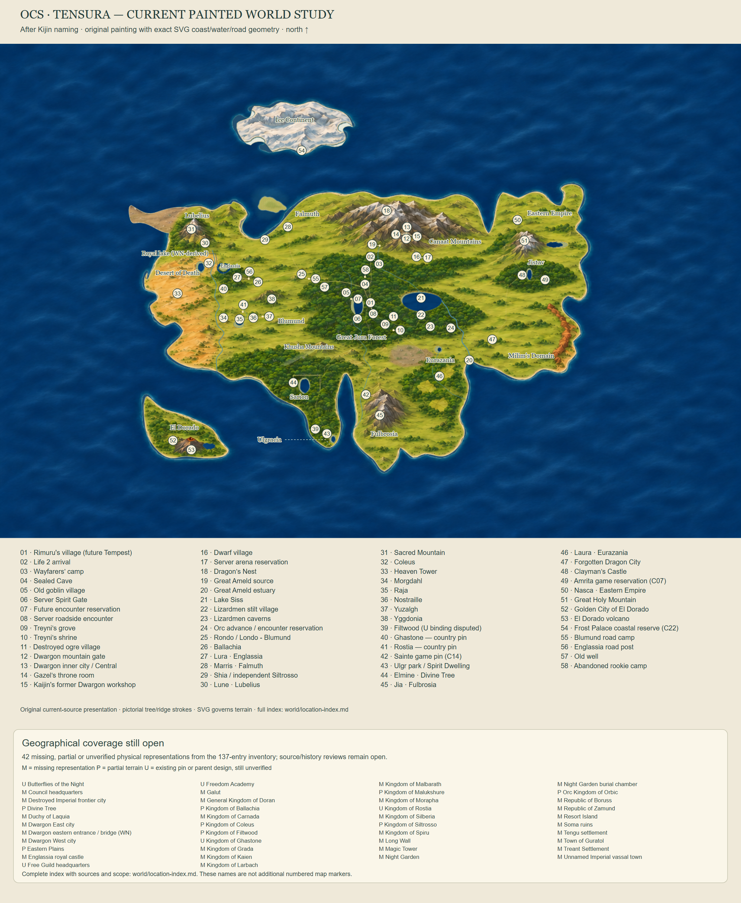

# Current painted atlas — R93 source/scope caption

[Editable atlas](atlas.svg) · [58-site registration](site-registration.json) · [caption audit](audit.json) · [R92 terrain composition and detailed limits](../painting-round92/README.md) · [R92 continent](../painting-round92/continent.png)

The painted geography is the exact R92 composition, still aligned with production source `43fed303`. R93's [source/era review](../empire-chronology-r93.md) adds one future-only WN relay-town entry to the location inventory. The current caption therefore says **137**, while **42 initial physical follow-ups** remain. This is a source/scope correction, not an additional initial town, assigned coordinate or change to the 58 registered sites.

Only the caption and panel inventory-round/count attributes change. The entire embedded R92 continent PNG,58 number groups,old leaders,18 context names and42 visible open rows remain identical. Site-registration metadata differs only in inventory136→137. Existing browser overlap results remain valid by unchanged marker/text positions and font geometry; only one lower-panel digit changes. The source SVG, terrain, original continent composition and old painting files remain unchanged. No image generation, raster editing, converter rerun, Minecraft chunks, main merge or deployment.

The S1E10 post-Kijin snapshot, WN qualification, authored terrain choices and unbuilt castle remain as documented in R92/R93. Later transport and Dungeon development are not activated. Ledger299 and inventory137 do not certify exhaustive primary-source or wiki coverage. Full map and local scope panel visually inspected. Required repository gate: **472 tests, 26 skipped, zero failures (64.176s)**; zero changed JavaScript.
