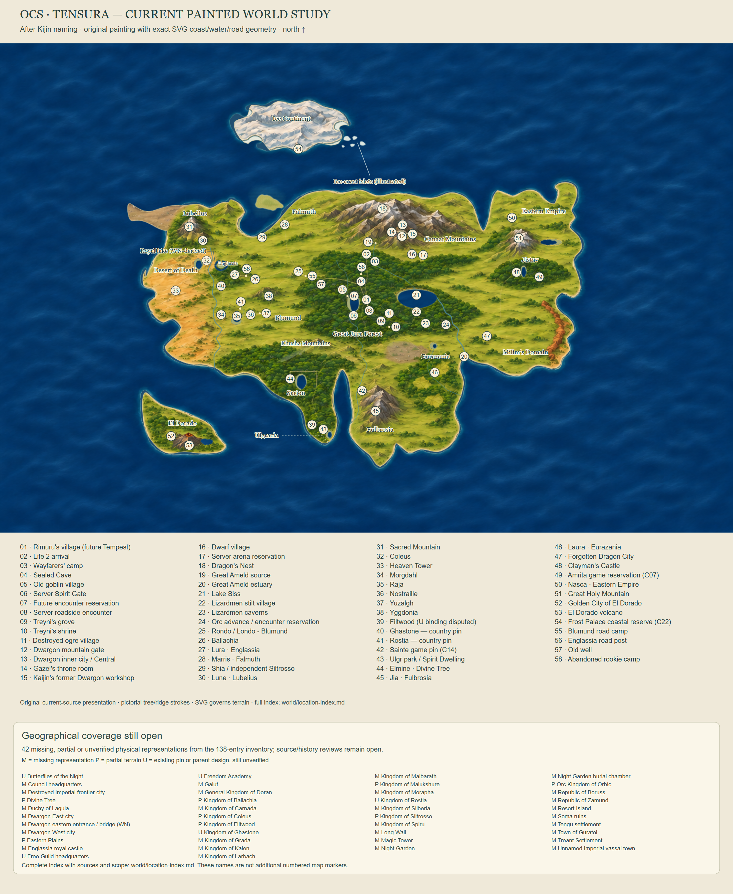

# Painted Ice offshore group — R95

[Editable atlas](atlas.svg) · [native continent](continent.svg) · [continent PNG](continent.png) · [before/after](comparison.png) · [source comparison](comparison.md) · [independent audit](audit.json) · [58-site registration](site-registration.json) · [provenance](provenance.json)

The painting follows [R94 geography](../ice-islets-r94.md), map commit `b7a19f2d4a728ef20db730e2f8c01be70d4f3d2b`, source **63df718534438fa803fc39a8a0b16c46bf9648edf1c58cc62fff30ad75f37806**. It now includes the five representative offshore coasts, a nineteenth context name and the current 138-entry inventory caption. R92/R93 remain unchanged as historical evidence.

## Original local composition

The exact R92 continent PNG supplies the underpainting; its full earlier native SVG is retained hidden and unmodified. An outer XML base keeps its relative native resources pointed at the original R92 directory. No copyrighted reference pixels are embedded or used as generation inputs.

All **five native painted coast polygons use the exact R94 source vertices**. An original cold snow/rock wash and fine shoreline strokes sit over the old ocean. **1,869 independently checked four-block samples** use the actual normal height gradients for restrained directional light. The two-world-block softening and palette are illustration choices; the image is not an absolute-height or terrain-material encoding.

**455 continent pixels change**, maximum RGB-channel difference **219/255**, bounds x715..766,y193..218. Every changed pixel centre lies within the new native islet outlines buffered 16 world blocks; measured distance beyond that support is 0. The buffer permits coast strokes and antialiasing; it is not an extension to the terrain polygon. The exterior remains the exact R92 underpainting. No unrelated coast, old lake, river, mainland, relief, settlement or island moves in the painting.

## Atlas and registration

All **58 site attributes, world coordinates and projected anchors** match the current source and remain unchanged. Existing marker groups, old leaders, previous 18 context labels and 42 visible open rows retain their exact atlas XML/layout. The new **Ice-coast islets (illustrated)** name and leader identify the offshore group without claiming a sovereign mask. Metadata for all 19 context positions is checked against actual SVG coordinates.

The caption now agrees with inventory **138/42**, and panel count/round attributes follow the current presentation. Browser checks find 58 numbers, 19 names and 42 open rows, with no label/number or label/label overlap; minimum bubble spacing **32.47px**. Existing country-label fits remain by preserved old country footprints/visible labels; no country-mask fit is asserted for the new offshore callout.

## Source and initial-era limits

[The R94 source review](../../docs/research/tensura-world-2026-11-19/ice-islets-source-review-r94.md) records the official illustration's detached rocky forms and the privately inspected original hash. This is canon-implied visual geography. Five islets are an original representative compression, not a directly verified exact count or a named canon archipelago. Coast shapes, scale, cold palette, material texture, heights and administrative I coverage remain **our interpretation**. The current native/source outline is not a measured runtime shore: coastal wiggle and grading still apply.

The snapshot remains immediately after Kijin naming, anime S1E10. No new village, palace, named roster, later construction or political outcome is introduced. C12 scale and C22 palace-placement questions remain. Ledger 301, inventory 138 and 42 indexed physical follow-ups are unchanged by this presentation pass; broader source and era questions remain open. Counts do not certify exhaustive wiki or primary-source coverage.

The final checker preview, R94 original terrain study, local painted detail, full painted atlas and original painted before/after study were visually inspected. No additional production SVG correction was identified. Source SVG, terrain previews, historical art PNGs and exact prompts remain unchanged after adopting R94. No new normal export, terrain application, Minecraft chunks, protected runtime/tool/mod edit, main merge or deployment. Claude handles technical conversion and placement.

PNG files are browser exports of original native SVG compositions; no new AI image or raster editing. Adopted source checker: **0 errors,56/56 relations,2 existing warnings**. Repository gate **472 tests, 26 skipped, zero failures (63.796s)**; zero changed JavaScript.
