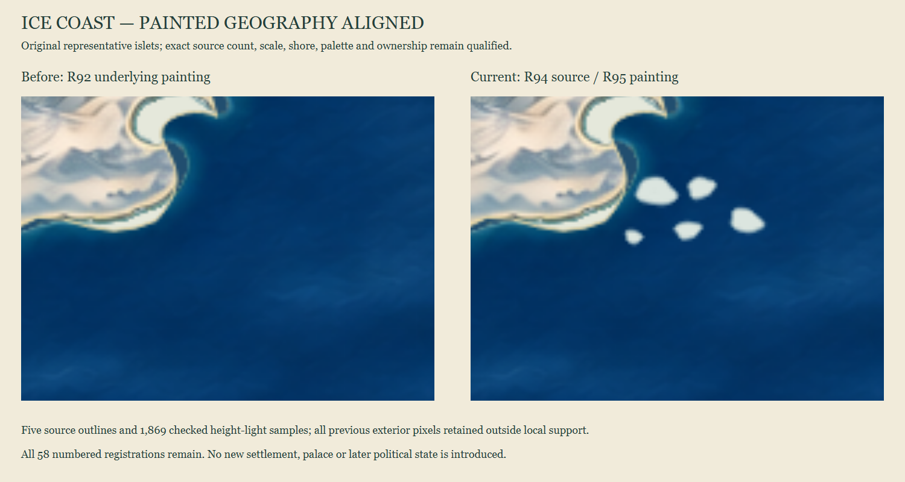

# R95 geographical comparison

The left panel retains the exact R92 continent PNG, which is also the underlying geography in R93. The right panel adds the five active R94 coastal polygons with original snow/rock styling and source-height directional light. Both panels use the same world frame. Compare the [R94 original terrain study](../ice-islets-r94.png) and [current terrain atlas](../atlas.png).

The [official introductory illustration](https://www.ten-sura.com/4GfGdAp7/wp-content/themes/tensura_portal/assets/images/portal-map/world/intro/map-base.webp) remains an external geography reference. Its pixels are not copied into this composition. [R94 provenance](../../docs/research/tensura-world-2026-11-19/ice-islets-source-provenance-r94.json) qualifies the small visible rocky forms. The representative number, outlines, scale, palette and ownership are original interpretations; the image does not establish a measured archipelago or a particular construction date.

All 58 site reservations, existing number groups and old labels remain registered. The nineteenth name is a source-qualified offshore-group callout; the138-entry caption retains42 open physical rows. The entire atlas and the enlarged local detail were visually inspected, alongside the final checker preview and both original before/after studies. No further production geometry correction was identified. C12/C22 and broader source/era obligations remain open; no runtime coastline acceptance is claimed.
