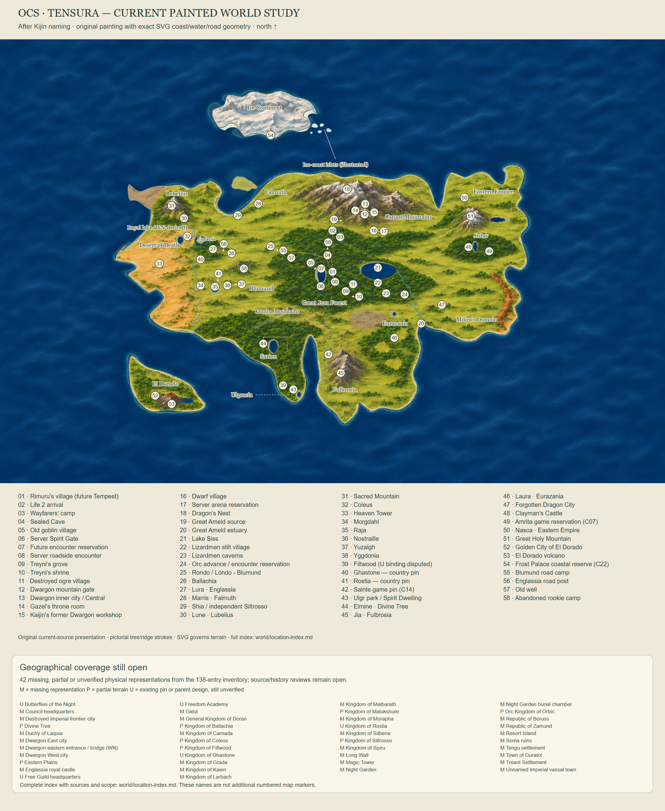

# Painted western coast aligned with current terrain - R98

[Editable atlas](atlas.svg) · [native continent](continent.svg) · [continent PNG](continent.png) · [before/after](comparison.png) · [source comparison](comparison.md) · [independent audit](audit.json) · [site registration](site-registration.json) · [provenance](provenance.json)

This painting follows [R97 geography](../western-peninsula-r97.md), map commit `ddfc721ffcb0daeb360ad79db36c09d710dc409a`, source **bb0e4b295dc1b75b8ac2778dd4f8b5240b69c26af5c4da35beac785595e6aaca**. The western lobe now extends beyond a shorter northwestern headland, matching the illustrated relationship recorded in MAP-WES-097. R95 remains the preceding historical painting.

## Original composition and source geometry

The exact R95 PNG supplies the underpainting. Its full native SVG is retained unchanged in a hidden history group, with an outer XML base pointing to the R95 directory. This preserves the old document; it is not a new verification of every resource inside older hidden history.

The active mainland boundary and land clip use the **exact current source path**. Four western biome shapes also use their exact source geometry. The source's V gameplay coverage does not become a painted sovereign border.

The earlier original painting supplies the local land and ocean texture. A native SVG mesh follows the two-stage R97 western adaptation, with **3,201 independently checked triangles**. Six-world-block overlap between neighbouring texture clips prevents rendering gaps; the exact mainland and local-support clips still govern the result. This texture interpolation is illustration, not a replacement coastline or a new geographical survey.

**32,050 independently checked samples** use the current normal height gradients for restrained directional light. Palette, texture, light, softening and the original ocean wash remain artistic choices. The painting does not encode absolute block elevations or Minecraft materials.

The change support derives from the changed R97 height, biome and ruggedness cells. A 48-block core buffer, 12-block edge blur and another 48-block outer support contain the local reconstruction. **42,499 continent pixels change**, with maximum RGB-channel difference **242/255**. Every changed pixel centre lies inside that declared western support. Outside it, the R95 underpainting remains exact. No unrelated island, relief, river, city or forest is redrawn.

## Atlas and registration

All **58 site attributes, world coordinates and projected anchors** match the current source. Every previous marker, leader, context label and open-row element retains its atlas XML/layout. Context metadata agrees with the actual positions of all **19 names**.

The inventory caption remains **138 entries / 42 physical follow-ups**. Browser checks find 58 numbers, 19 names and 42 open rows, without label/number or label/label overlap. Minimum bubble spacing remains **32.47px**. Artwork and a country pin do not complete a country or establish its capital.

## Source, era and review limits

[The R97 source review](../western-peninsula-r97.md) links the official illustration and distinguishes its visible silhouette relationship from authored coordinates. The final mainland is 9,983 × 6,250 blocks. Its wider rejected alternative remains an inactive source comment because the repository requires width at most 10,000. C12 scale adaptation remains open.

The snapshot remains immediately after Kijin naming, anime S1E10. No later building, character roster, political outcome or event is introduced. Heaven Tower's staged preparation ground of 73 and the associated caravan profile remain the technical handoff recorded in R97; this painting does not apply those records to a server.

The final continent, full atlas, local detail and original before/after were visually inspected against the current terrain preview and official silhouette reference. No further production SVG correction was identified. Ledger **304**, inventory **138** and **42 physical follow-ups** remain unchanged. Broader source, location and initial-era obligations remain open.

No copyrighted reference pixels, new generated image, raster editing, place-art/prompt modification, protected implementation edit, new normal build, terrain application, chunk generation, main merge or deployment. PNGs are browser exports of the original native SVG compositions. The adopted source checker has 0 errors, all 56 relations passing and 2 existing warnings. Repository gate: 472 tests, 26 skipped, zero failures (63.532s); zero changed JavaScript.
