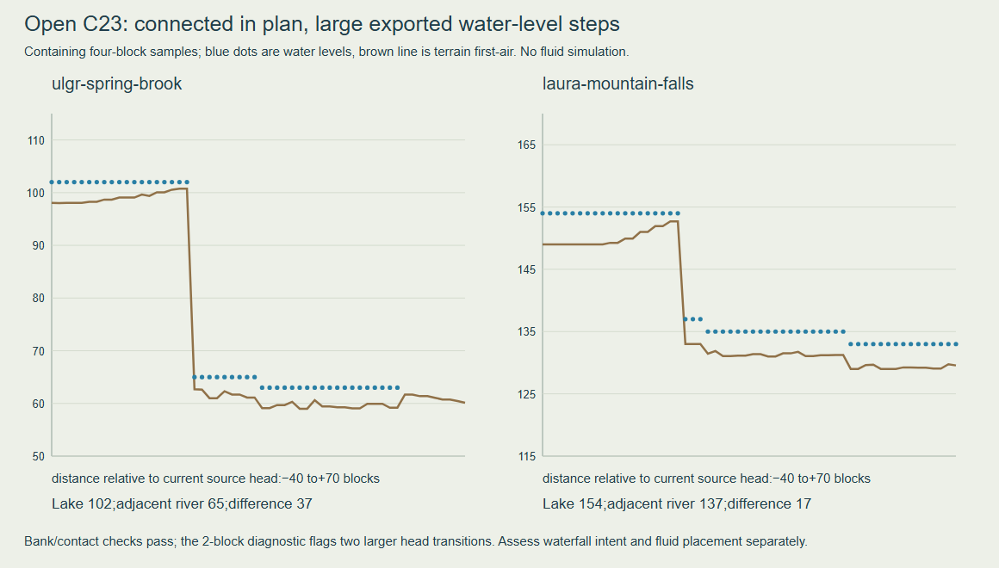

# C23 review: larger initial water-level transitions

[Eight interfaces](river-head-profiles-r115.csv) · [Full diagnostic](river-head-profiles-r115.json) · [Measurement script](river_head_profile_audit.py).

Ulgr’s lake level 102 meets exported river level 65, a 37-block difference. Laura’s lake level 154 meets river level 137, a 17-block difference. Six other measured interfaces have differences of at most two blocks. These are adjacent four-block export samples, not simulated fluid columns or canonical waterfall heights.

Run `python -B world/river_head_profile_audit.py` against source `89b01c4c` and matching normal staging. It intentionally returns 1 for the two flagged transitions. The standard map checker passes; it does not test this vertical property. The separate lake-bank/contact audit passes all 13 cases within its own scope.

The two-block threshold is a diagnostic choice matching the converter’s ordinary `MAX_STEP`. The owner brief asks for small falls but imposes no exact numeric cap. Larger transitions therefore require assessment against the intended landscape and source cues; this threshold is not an additional owner requirement. The converter can force a larger initial drop when the remaining reach is too short for its normal steps. Do not lengthen streams artificially merely to satisfy the diagnostic. No tools implementation change is authorized by this report.

Baseline levels were already 102→65 at Ulgr and 154→135 at Laura. The contact repair retains Ulgr’s first reach and raises Laura’s to 137. Moving the heads establishes contact in plan, without proving the vertical transition acceptable. Terrain changes at the moving cliff cuts range from −41.375 to +41.3125 blocks over 188 samples. No changed height sample lies inside a registered site disc; all 58 site attributes, site exports and roads remain unchanged.

C23 remains open for waterfall character and fluid-placement assessment. Other source, proportion and era requirements also remain open; this is not full-map acceptance.
