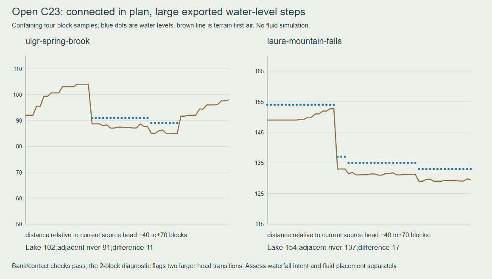

# River-head profile review — R119

[Eight interfaces](river-head-profiles-r119.csv) · [Data](river-head-profiles-r119.json) · [Route correction](ulgr-brook-r119.md).

Ulgr’s first adjacent water difference is now 11 blocks instead of 37; Laura remains 17. Six other interfaces remain within two blocks. Run `python -B world/lake_bank_audit.py --round 119`, then `python -B world/river_head_profile_audit.py --round 119` against exact matching normal source `4093f844`. The former passes all 13 lake cases; the latter intentionally returns 1 for the two diagnostic flags. Neither is a Minecraft fluid test.

The two-block criterion is a diagnostic choice, not an exact owner limit or canonical waterfall height. C23’s former offshore Ulgr course is repaired. Waterfall character and actual fluid placement still need assessment; do not create artificial stream loops merely to satisfy the threshold. The larger source, proportion and initial-era goal remains open.
