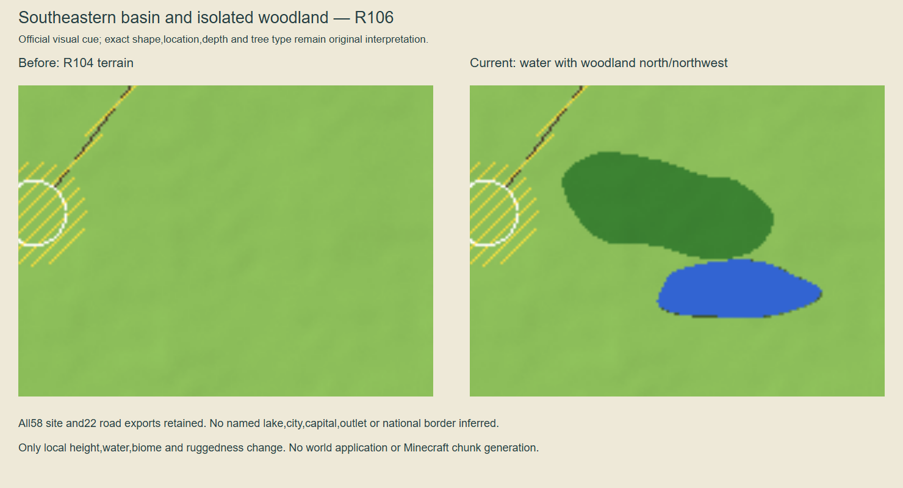

# Southeastern water and isolated woodland — R106

[Current atlas](atlas.png) · [checker preview](preview.png) ·
[editable comparison](southeastern-water-wood-r106.svg) · [audit](southeastern-water-wood-r106.json) ·
[official reference links](comparison.md).

The official introductory illustration shows a small inland water shape in the
southeastern mainland lobe with an isolated woodland patch to its north/northwest.
These distinct visible features were absent from the earlier production layers.
MAP-SE-106 records the visual relationship as **canon-implied**,not a named or
surveyed LN lake. The original image was opened through the public web tool and
reinspected locally beside the checker map. References remain links/private
originals; no copyrighted reference pixels or traced vertices are distributed.

## Original adaptation and deliberate differences

DES-SE-106 records the exact design as **our interpretation**. The36-vertex
`southeastern-unnamed-basin` is approximately centred(3430,1040),bounds
x3184.89..3698.39,z944.47..1125.15,area70,513.41 blocks²,level68,maximum depth4.
The66-vertex `southeastern-isolated-woodland` lies north/northwest,bounds
x2888.61..3550,z607.20..941.18,area155,470.88 blocks². The closest source-edge
gap is6.58 blocks. Its light tree type,density,tree species and exact boundary
are original choices. A preliminary south-side woodland draft was corrected
after direct image reinspection; the final geometry follows the visible side.

These are unnamed landscape features,not a royal moat,capital reservation,
verified national frontier or a dated initial-era forest/water condition. No
outlet is invented where the illustration does not establish one. Location,
scale,shore,water level,depth and forest boundary remain inferred adaptation
within the current server proportions; direct LN agreement is not established.
All initial-story politics,conquests and resident rosters remain separate.

## Verification

Final standard checker:0errors/56relations/2prior warnings (Laura escarpment and
preferred box size). Normal staging67.7s; source **b275095000ed41e635c72295d05dbd3516cf8fd0c596a7a0e7a9fe14159815e1**.
No `--apply`. The map now has13 lakes/13 forests; all9 coasts,9 rivers,14 mountain
polygons,10 hills,27 biome polygons,28 region polygons,22 roads,58 sites and4
ridges are retained. Every prior active XML element is unchanged.

Exported sites.json and roads.json remain byte-identical. The lake's nearest
site edge is497.03 blocks away.4406 lake-core cells all carry water68; designed
bed height64..66.75 reflects rim taper rather than a uniform rectangular cut.
The woodland covers9714 raster cell centres. No old site or road was moved.

Height and water each change4406 cells inside the new lake. Biome changes14122
cells inside the new features. Ruggedness changes5041 cells within8.92 blocks
of them. These are current designed-raster measurements,not final terrain-noise,
vegetation-density,Minecraft-flow,chunk-generation or in-game-fit acceptance.

Atlas XML retains58 numbered markers and20 context names. Milim’s orientation
text moves south from local y1344.23 to1395 so it does not sit over the new water;
all other text positions remain fixed. This is a label-layout change,not a place
or sovereign-boundary change. Caption and
panel metadata now both say142/42; this also corrects panel metadata that still
said138 despite the previous visible140 caption. Browser inspection covers
58 circles/20 names/42 rows with no label overlaps; minimum number spacing31.62px.
Ledger312 unique; inventory142 retains every prior140 row/classification and all
42 existing physical follow-ups. Added unnamed terrain does not certify full
wiki traversal,complete cities or initial-state construction.

The checker preview,terrain comparison and atlas were visually reviewed beside
the official reference. [R107 painting](https://github.com/Yasuke2000/ocs-two-lives/blob/e28b579/world/painting-round107/README.md) now follows these additions and the142-entry caption. R105/source e785c2b0 is historical. Existing place art remains
unchanged. C12/C22 and the broader source/physical/initial-era obligations remain
open; Yasuke's palace-placement response is still pending.

Repository gate:472 tests,26 skipped,zero failures(64.959s); validation,
zero changed-JavaScript check and `git diff --check` pass. Final atlas geometry
comparison retains all prior numbered groups/other text except the declared
Milim orientation move,image,source and caption/panel metadata.
