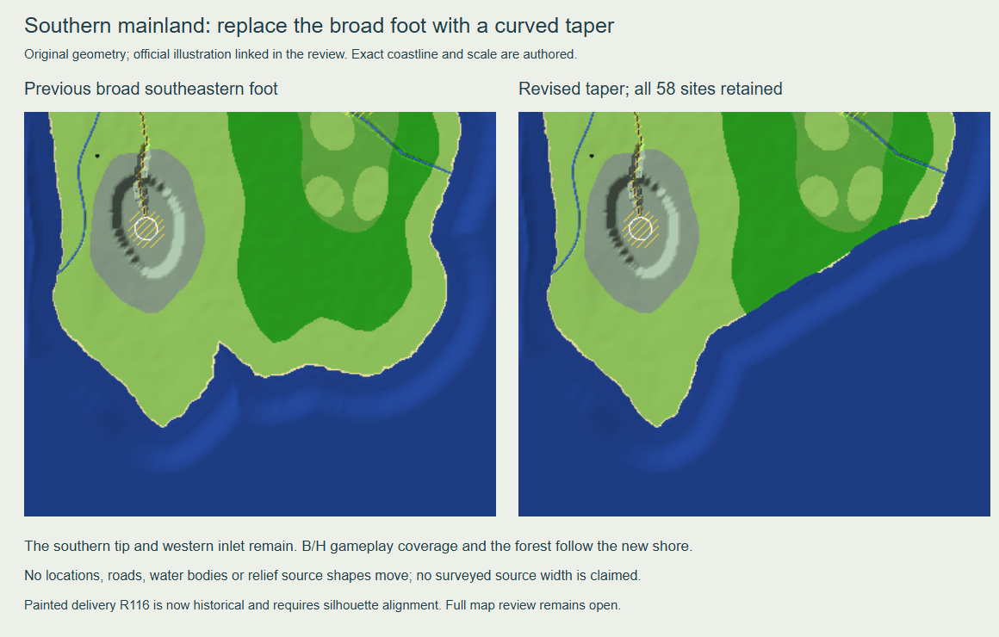

# Southern coast silhouette correction — R117

[Geometry/export audit](southern-coast-r117.json) · [Editable comparison](southern-coast-r117.svg) · [Current numbered atlas](atlas.png).

The [official introductory illustration](https://www.ten-sura.com/4GfGdAp7/wp-content/themes/tensura_portal/assets/images/portal-map/world/intro/map-base.webp) shows the southern mainland ending in a narrow, curved landtongue. The previous authored southeastern foot was broad and rounded. The original 1250×960 image was reread beside the checker preview. This is a visual silhouette cue, not a surveyed width, bearing, political border or known map projection (MAP-SOUTH-117).

Five original cubic reaches replace the broad southeastern foot. The southern tip, western inlet and mainland bounding box are retained. B/H gameplay masks and the existing Eurazania forest are clipped to the new shore. The exact coastline and clipped woodland edge are our interpretation (DES-SOUTH-117). No reference pixels or traced shore file is copied into the repository.

The correction removes 819,604.48 square blocks of native land and adds none. Authored cross-section widths decrease from 2,339.43 to 1,158.87 blocks at z3000 and from 1,943.80 to 762.90 at z3200. These compare two designs; they are not source-map measurements. Current mainland bounds remain 9983×6250 and the design box remains 12800×10752. C12’s global scale/projection limitations remain.

## Terrain and fixed reservations

Every native element other than the coast, two gameplay masks and forest retains its attributes and text. All 58 sites, 22 roads, lakes, rivers, biome selectors, relief and detached coasts remain. Normal staging takes 67.0 seconds without converter warnings. Height changes affect 172,196 cells and reach 92.4375 blocks at the changing coast; ruggedness changes affect 59,213 cells and biome changes 52,514. Do not call this merely a cosmetic change. No changed height centre lies inside a registered site disc or any native lake plus an eight-block buffer. This preserves the prior finite lake-bed and cardinal bank-ring height samples as well as their water levels.

Water, road, site and exclusion PNGs, site/road JSON and anchor/site TOML are byte-identical. Therefore R115’s finite lake checks and R113’s site-art reservations remain applicable within their original scope. The [R117 regional census](region-biomes-r117.md) replaces current distributions because coastal land area changed. All 22 regions are measured with no unassigned inland biome samples. Road-profile and in-game terrain/fluid acceptance are separate from these export comparisons.

The default checker passes zero errors and all 56 relations, with the two existing warnings (Laura escarpment and preferred design size). The current checker preview, official original and local comparison were visually inspected. Atlas layout retains 58 numbers, 20 context names and 42 inventory rows without label overlaps; minimum number spacing 31.62 pixels.

## Remaining work

At source review R117, the R116 painting still depicted the previous southern foot. [R118 on this proposal branch](painting-round112/README.md) now aligns the silhouette, with the prior snapshot retained in Git history. Full proportional fidelity, initial-era semantics, missing settlements and C23 waterfall-character/fluid-placement review remain open. Source access attempts could not enumerate the Orbic/Ulgracia child categories; parent article results do not establish complete coverage. No protected implementation, new registry ID, live world apply, chunk generation, main merge or deployment is included.

Required repository gate: 472 tests, 26 skipped, zero failures in 64.173 seconds. Validation and `git diff --check` pass. The source correction is a separate stacked draft over `chatgpt/world-map`; no main merge is performed.
