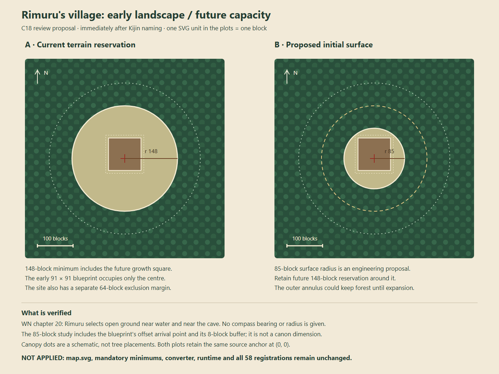

# Initial Tempest landscape and future capacity — round 46

The early village should read as a small construction settlement within Jura. The
production map currently reserves radius148 because the requirements generator
includes a **192-block future growth square**, rather than just the initial91×91
blueprint. This is an explicit project capacity choice, not a canonical village size.
The [native drawing](tempest-early-landscape-study.svg) compares that reservation with
a smaller initial surface; it is **not applied** and does not override the fixed contract.

## Direct source and limits

[WN chapter20](https://ncode.syosetu.com/n6316bn/22/#L143), HTML L143–L145, directly
describes Rimuru choosing open farmland-suitable ground near water and near the cave.
`WN20-001` records this. It supplies no compass bearing, lake name or clearing radius.
The existing western lake and southern-pond wording in the legacy place guide must
not be promoted to a verified canonical orientation. The new world retains its authored
waters as interpretation; no water geometry is changed by this review.

`WN20-002` records the survey and sanitation discussion at L161–L164,L178,L226.
Planning is not evidence of completed infrastructure. Conversely, this earlier scene
does not prove that no further work occurred before the later Kijin naming. The selected
anime snapshot and official episode9/10 references still govern the era handoff.
Neither claim is silently upgraded to LN evidence.

## Proposed initial surface

Keep the registered future reservation at `(0,0),r148`. A **separate hypothetical
initial surface r85** could support the current initial blueprint while leaving more
canopy within the future expansion area. Exact shape, forest edge and radius are
**our interpretation / DES-JUR-046**, not a canon measurement. Canopy pattern dots
in the drawing represent schematic potential cover, not surveyed or accepted trees.
No roads, new water, new coordinates or populated structures are added.

The [audit](tempest-early-landscape-audit.json) derives85 from the existing generated
91×91 footprint, arrival offset `(45,57)` and margin8. Cell-edge bounds relative to
the arrival anchor are `[-45.5,-57.5,45.5,33.5]`; padded bounds are
`[-53.5,-65.5,53.5,41.5]`. Their farthest corner is84.5725 blocks away. Thus85
encloses that rectangle. A centred half-diagonal alone would underestimate this
offset footprint. This is a horizontal containment check, not runtime acceptance.
The two illustrative circle areas differ by67.015%; no percentage of actual trees,
biome cells or Minecraft clearing work is inferred from that calculation.

The outer dotted212-block circle is the current148 radius plus64 SVG structure
exclusion margin. Exclusion suppresses structure starts; it is not a tree-clearance
radius. The proposal does not change that margin, Jura's danger rings, portals,
the 58 IDs, any source site tuple, or the future town/city build specifications.

## Concrete technical handoff — C18

The current converter uses one site radius for flattening/biome treatment and raises
a smaller SVG radius back to its required minimum. Merely drawing85 in production
would therefore be a checker violation and would not implement this proposal.
Do not change technical limits to disguise that discrepancy.

Claude must decide how to represent **initial surface** separately from **reserved
future capacity**, preserve the191/192 future city envelope, and test era transitions,
tree clearance and an inhabited initial village before calling this applied. The
technical implementation is outside ChatGPT's authorized edit paths. The current
mandatory r148 and generated sites.toml remain intact. C18 remains open.

No new production SVG, checker preview, terrain export, biome, art or Minecraft
chunk is delivered. Source7d021766 and the current painted atlas remain geometrically
valid. No converter rerun, main merge, apply or deployment occurred.
