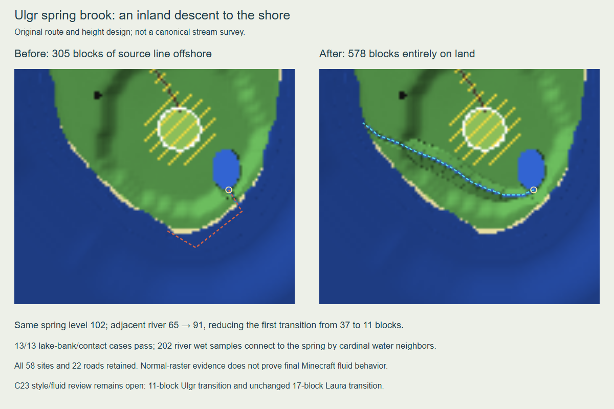

# Ulgr spring brook stays inland — R119

[Native/export audit](ulgr-brook-r119.json) · [Read-only connectivity measurement](ulgr_brook_connectivity.py) · [All 13 lake checks](lake-banks-r119.json) · [Head profiles](river-head-profiles-r119.png) · [Current atlas](atlas.png).

## Source and interpretation

The author-published [WN61 park passage](https://ncode.syosetu.com/n6316bn/64/#L80) was reread: it supports the doorway in a large rock and a distinct space beyond. It does not establish this spring’s surveyed route or waterfall height. Existing WN61-002 remains WN evidence, without being promoted to verified LN architecture. The owner brief independently requires a wooded bluff, elevated spring and stepped brook. The exact brook is our interpretation (DES-ULGR-119).

The old 358.68-block source line had only 53.25 blocks on land and 305.43 offshore; its intended remaining course was ignored by the inland reach design. The corrected 577.63-block route curves west/northwest over the existing landtongue to a snapped native-shore mouth, without offshore sections or artificial loops. Length is a consequence of the authored coastal route, not a canonical travel distance or a compulsory numeric diagnostic target.

The spring, lake level 102, river width 6, head 102 and mouth 63 stay fixed. Every other native attribute and text remains, including all 58 sites, 22 roads, coasts, water bodies, relief, biome and administrative shapes. All current ratios and country identities remain as previously qualified.

## Export evidence

Fresh normal staging takes 66.4 seconds without converter warnings. The adjacent exported river level rises from 65 to 91, reducing the initial drop from 37 to 11 blocks. Following river sample levels are 91,89,…,63. All 202 wet river sample centres connect to the spring by cardinal wet neighbors. The nearest level-63 river centre is 5.16 blocks from native shore. Seven containing-cell samples along the last reach and its continuation have first-air below sea level 63; these do not show a sampled above-sea barrier. Explicit river water ends at the coastal transition; default sea filling is a separate runtime concern.

All 13 lake bank/depth/contact cases pass: 42,760 matching wet lake samples, no strict interior holes/wrong levels, 2,539 external and eight boundary dry-bank samples with at least two blocks freeboard, and all eight designed contacts. These remain finite normal-raster checks, not continuous banks, final noise or actual Minecraft fluid acceptance.

Changes affect 1,729 height cells (maximum 44.875 blocks), 785 ruggedness cells, 220 water cells and four biome cells. No changed height centre lies inside any registered site disc. Road, site and exclusion PNGs, site/road JSON and anchor/site TOML remain byte-identical. The [R119 biome census](region-biomes-r119.md) reports current percentages and no unassigned inland biome sample. Art reservations remain unchanged.

## Remaining assessment

The [current profile diagnostic](river-head-profiles-r119.json) still flags Ulgr 11 and Laura 17 against its ordinary two-block threshold. That threshold is not an owner numeric cap, a canon contradiction or automatic map rejection. The old offshore-course problem is corrected; C23 waterfall-character and actual fluid-placement assessment remains open. Laura’s source geometry is unchanged. The public LN5 prologue was rechecked and supplies no verified numerical waterfall height here; the secondary anime-frame reference remains qualified.

Default checker: zero errors, all 56 relations, two prior warnings. Current preview, terrain comparison and atlas layout were inspected; 58 numbers, 20 context labels and 42 inventory rows remain without overlaps, minimum spacing 31.62 pixels. R118 painting still has the previous Ulgr brook and needs native route alignment before it follows this source. No new bitmap, protected implementation, registry ID, world apply, chunk generation, main merge or deployment. Ledger 324; inventory 142/42; wider source, proportion and initial-era review remains open.

Reproduce the current water/shore check with `python -B world/ulgr_brook_connectivity.py` against matching normal staging. The source and staging hash are pinned; no output or runtime data is mutated.

Required repository gate: 472 tests, 26 skipped, zero failures in 63.829 seconds. Validation and `git diff --check` pass. The read-only connectivity command also passes. The head-profile diagnostic intentionally returns 1 for the disclosed 11/17-block transitions; it is distinct from the repository gate.
