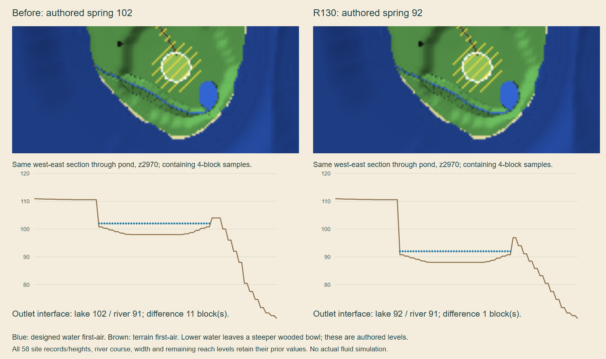

# Ulgr spring: a smaller head step and current regional guide — R130

[Editable study](ulgr-spring-level-r130.svg) · [Native/export evidence](ulgr-spring-level-r130.json) · [Current regional guide](regions.md) · [Guide reconciliation](region-guide-review-r130.json) · [All 13 lake checks](lake-banks-r130.json) · [Eight head profiles](river-head-profiles-r130.png).

## Design and source scope

The whole-deliverable review found an avoidable Ulgr head drop and stale regional prose. All 22 exported road profiles already meet the owner’s1:2 maximum grade, but the short brook has only enough normal-reach descent for its lower downstream levels. With the old authored spring at 102, the converter starts the river at 91, leaving an 11-block interface. Its intentional reach-budget behaviour is visible in the read-only `reach_levels` inspection; no converter code is edited.

**Our interpretation:** lower the spring’s `data-level` and the brook’s `data-head` from 102 to 92. The spring remains 29 blocks above sea level 63; the adjacent river stays 91, giving a **one-block interface**. Every horizontal vertex, pond depth 4, brook width 6, mouth 63, coast, relief/forest shape and all other attributes remain. This avoids adding artificial river loops to meet a numeric diagnostic. The ordinary two-block threshold is not an owner-set exact waterfall cap.

The author’s [WN61 park passage](https://ncode.syosetu.com/n6316bn/64/#L80) was reread: it describes the doorway in a large rock and a different space beyond. That supplies no surveyed spring altitude in the selected passage. Existing `WN61-002` stays WN-continuity evidence, not verified LN architecture; the water choice is the new authored record `DES-ULGR-130`. The later visit, students and labyrinth events are not instantiated at the S1E10 snapshot.

## Actual terrain consequences

Fresh normal staging takes 67.5 seconds without converter warnings. Exactly two native attributes change. Height changes affect 693 four-block samples, maximum 10 blocks; water level changes affect 509 samples, also 10 blocks. Ruggedness, biome, road, site and exclusion PNGs are byte-identical. All 58 site records/heights, site/road JSON and anchor/site TOML remain byte-exact, as do every exported river reach and all 22 road profiles. The Ulgr park entrance stays at its previous height.

Lowering the water leaves a steeper wooded bowl below the unchanged bluff. Existing dry sample centres within 8 blocks of the pond have up to 20 blocks of bank relief above the new water, compared with 10 before. That diagnostic includes the designed outlet corridor, where freeboard differs from an ordinary shore. The before/after cross-section makes the larger western rock bank explicit; this is not presented as a harmless metadata-only edit. The pond depth remains 4 blocks. The bounded terrain/section view was inspected; final noise and travel remain separate integration checks.

All 13 lake bank/depth/contact cases pass, with eight designed contacts. All 202 wet brook-route samples remain connected to the spring and the measured mouth continuation stays below sea level. The current head diagnostic now passes 7 of 8 ordinary-step interfaces: Ulgr 1, with Laura’s unchanged 17-block head difference remaining open under C23. That command intentionally returns 1 for the disclosed Laura diagnostic; it is separate from the repository gate. No actual fluid-column or in-game simulation is claimed.

Every one of the22 exported road profiles stays within 0.5 maximum grade using 1e-6 floating-point tolerance; none contains a vertical duplicate-coordinate segment. These are finite point-profile checks, not continuous final-noise or in-game traversal acceptance.

## Regional guide reconciliation

`world/regions.md` now reads as a current guide instead of 694 lines of mixed snapshot status. All 22 region narratives and all 69 curated image links remain. Each region has landform/heights, current designed biome mix, palette/crossing, explicitly interpreted mood, canon basis and qualified reference roles.

The guide corrects the stale coastal-palace crossing, the pre-R125 El Dorado dimensions and the old Ulgr 102/11 description. Its inline biome rows now use actual R128 values, including the changed Ice/El Dorado shares. The R128 biome PNG hash and every region node match the R130 source exactly; there is no need to duplicate 106 census rows just for a new source hash. The previous chronology remains in Git history and linked reviews. The guide shrinks from 111,009 to 57,746 characters while preserving the curated links; this does not independently verify every inherited canon paragraph.

## Delivery boundaries

The current terrain atlas embeds the exact normal preview and retains its existing annotations. The R129 painted atlas’s plan geometry remains compatible and is adopted as an illustration; its original source pin remains historical, with no image regenerated or falsely labelled as a vertical-height reconstruction. R127 art registrations remain numerically applicable because all 58 site records/heights are unchanged.

Ledger 333 contains one new authored water-design record, with required claim/source/locator/URL/confidence fields checked. This does not prove semantic truth of every older record or exhaustive wiki coverage. The [whole-deliverable review](../docs/research/tensura-world-2026-11-19/delivery-review-r130.md) separates proven artifact/numerical checks from open source/contract/era work. No tools/mod/pack edit, live apply, chunks, main merge or deployment.

Required gate: validation passed; 472 tests, 26 skipped, zero failures in 65.094 seconds. Default checker: zero errors, all 56 relations, two standing warnings. `git diff --check` passed. The separate head-style diagnostic remains intentionally nonzero for Laura17.
