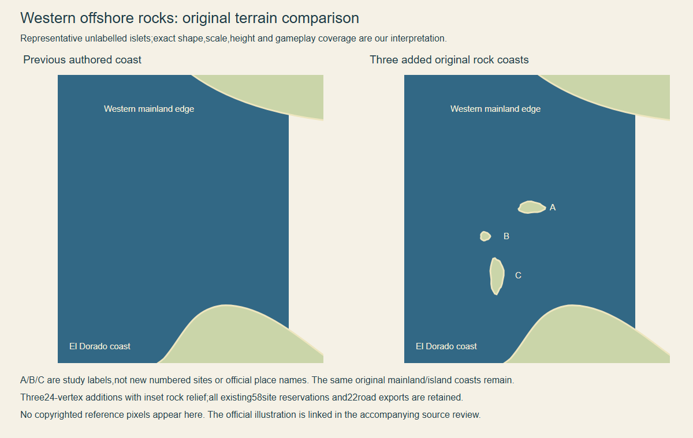

# Western offshore rocks: source-informed original terrain

[Measurements](western-offshore-islets.json) · [editable study](western-offshore-islets.svg) · [current atlas](atlas.png) · [fresh biome census](region-biomes-western-islets.json).

## Source and interpretation

The directly inspected [official introductory illustration](https://www.ten-sura.com/4GfGdAp7/wp-content/themes/tensura_portal/assets/images/portal-map/world/intro/map-base.webp) shows three small unlabelled forms off the southern western shore,north of El Dorado and west of Sarion. The licensed guide8.5 front map repeats this illustration;it is not independent proof of exact coordinates. A fresh official asset request returned200 and identical bytes to the inspected image. Source images stay private;this repository contains only original coasts and links.

Add three representative24-vertex rock coasts,with inset rolling rock relief,windswept gravel biome and disjoint Xgameplay coverage. X is the nearest neighbouring island gameplay zone,not a finding that Leon owns them. No official names,extra site circles,buildings,events or ownership dates are inferred. Shapes,dimensions,spacing and heights are our interpretation. The original large-island fixed-size conflict remains separate.

## Current terrain evidence

Current source SHA256 `50c27a6ff1e8d9f39ee9f5571062ef2b7b25ed5a3a16760dcd4ca9e9d334b561`. Fresh normal staging67.6seconds. All prior active elements remain;only three coasts,three hill envelopes,three biome footprints and three coverage footprints are appended. The mainland,existing islands,58site attributes and22road source courses remain exact. All58site/anchor exports and22road exports are byte-identical. All lake/river levels/reaches are exact;no changed height/water sample enters any site disc or lake+8-block neighbourhood. Existing finite13-lake checks are retained through these invariant inputs,not relabelled as newly run fluid tests.

11778.89 square blocks of original native land are added;none removed. Existing main/island outlines and design bounds remain. Sampled maximum first-air levels are 65.3125, 64.0000, 65.4375;each islet has at least one four-block centre at64or higher,above sea63. These are low rocks,not hills as tall as their scalar controls. The smallest initial trial reached only63.375;its original coast was retained and its height control raised to90. Boundary warnings were removed by keeping relief footprints inside the coast. No new standing warning is accepted.

Height/rugged cells change 31474/2091. Raw biome indices differ at173123cells because adding a palette name also renumbers existing entries. **Only574cells change biome name**. Water,road,site and exclusion PNGs are byte-identical. Fresh22-mask census has zero unassigned inland non-ocean samples;all21other regional biome counts are unchanged. Xnow includes the explicitly interpreted rocky-islet context. See the detailed report for raw/semantic bounds.

## Rendering and remaining scope

The source atlas uses the fresh normal terrain image and one unnumbered offshore-rock callout. All58 numbered reservations remain. The expanded location inventory becomes143entries,with42prior physical follow-ups;the source discovery table has139rows because the expanded inventory includes additional scope-routing entries. Ledger346. The actual local islet painting is available in [companion PR130](https://github.com/Yasuke2000/ocs-two-lives/pull/130), with its own pixel/provenance audit; the source-aligned [regional guide](regions.md) uses the fresh census.

Normal rasters do not establish final noise,fluid behaviour or Minecraft chunk acceptance. The smallest rock is low;its survival and appearance after technical noise remain an integration check. No runtime files,tools,mods,pack assets,main merge,world apply,chunk generation or deployment were changed. This is source authoring for Claude's converter/integration work.

Required repository gate passed:472tests,26skipped,zero failures(65.543s);validation and diff check pass. Standard checker0errors,56relations pass,2standing warnings;normal converter has no warnings. Preview,source atlas and original before/after study visually inspected;new atlas callout has no text overlaps.
